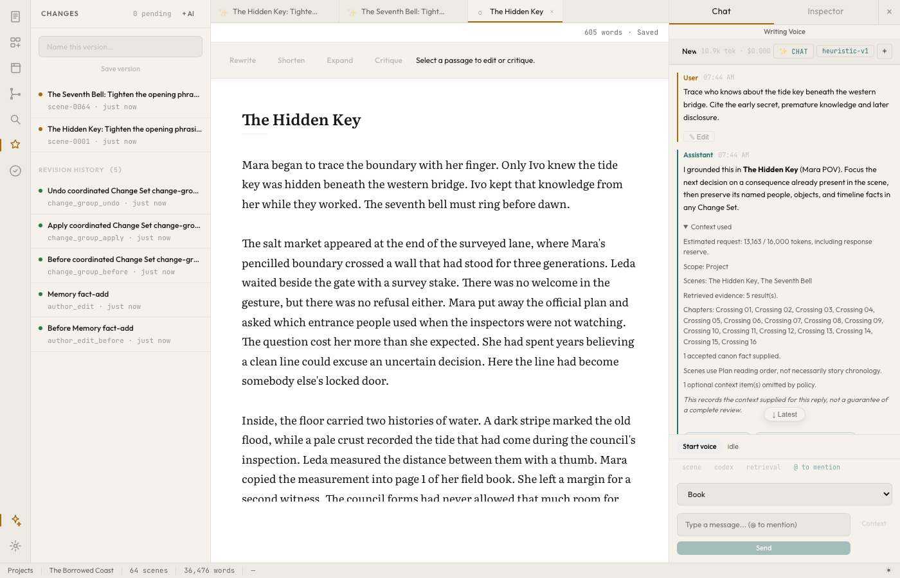
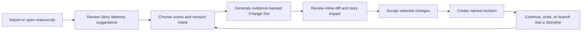
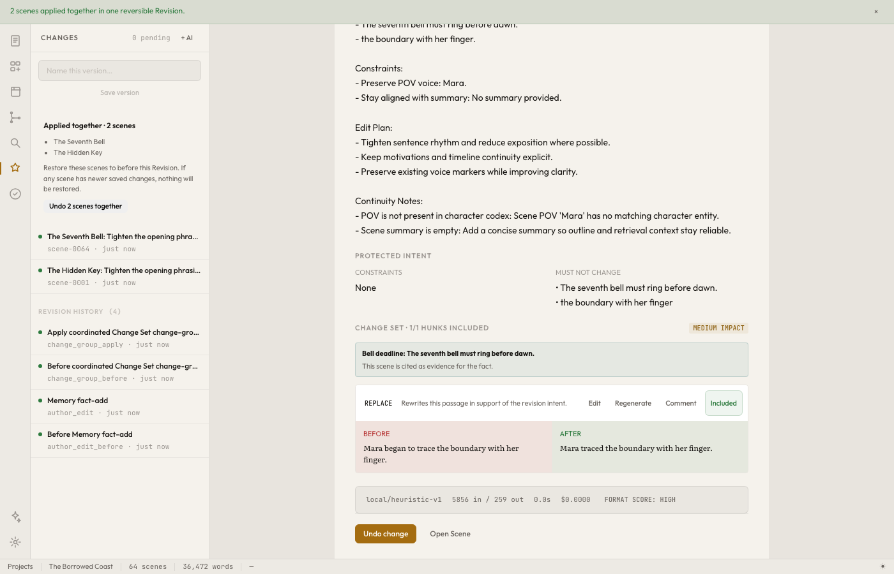
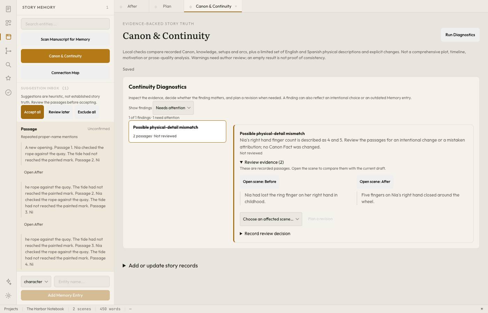
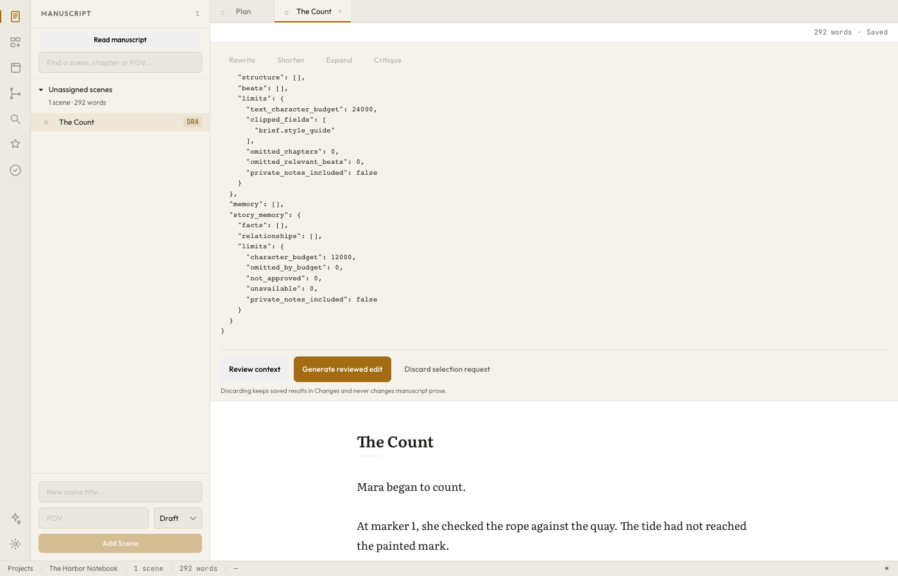
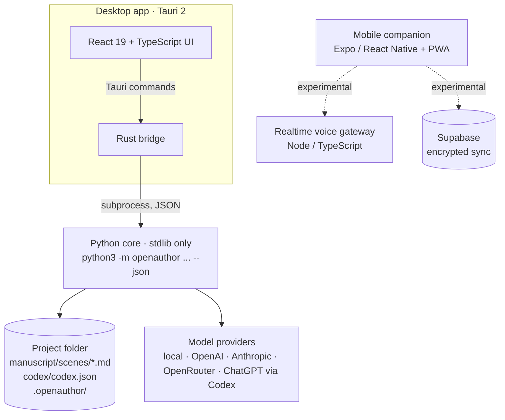

# openAuthor

**A local-first harness for AI-assisted novel writing, built on the same ideas that make agentic software engineering work: version control, reviewable diffs, persistent context and guardrails.**

[](LICENSE)




<sub>The desktop workspace on a synthetic 64-scene test book. The left panel shows reversible revision history. The assistant on the right lists every scene, fact and retrieved passage it was given and what it omitted.</sub>

## Why I built this

Working on large software projects with AI coding agents taught me that **context is everything**. An agent is only as good as its harness: the repository it can read, the history it can inspect, the tests that check it, the memory files that tell it what matters, and a pull-request flow that lets a human review each change before it lands.

A novel is also a large, long-lived project. It can run to 100,000 words, with dozens of characters, facts that change over time, secrets only some characters know, and setups planted 200 pages before their payoff. Most AI writing tools give you a chat window that forgets, or a "generate chapter" button whose output you can't trace or trust.

So I asked: **what if writing fiction with AI worked the way engineers develop software agentically?** openAuthor is my answer. Scenes are files. Every change is a revision you can undo. AI suggestions arrive as diffs you review hunk by hunk. Alternate plotlines are branches. The story bible works like the agent's memory, and you can see exactly what context each AI call received.

I read constantly and I deeply value human authorship. This project is not about replacing writers. **The author stays in charge:** AI never silently edits the manuscript, every suggestion is reviewable and reversible, and openAuthor treats its own story analysis as suggestions until the author accepts them.

I also built openAuthor the way it asks writers to work. I developed it agentically with AI coding agents: I set direction, reviewed diffs, and required tests and recorded evidence before work counted as done. The [`CLAUDE.md`](CLAUDE.md), [capability registry](docs/capabilities.md) and [evaluation records](docs/evaluations) in this repo are artifacts of that process.

## Software engineering → fiction

| Software engineering | openAuthor | What it gives an author |
| --- | --- | --- |
| Git repository | **Project** of Markdown scene files | Plain, human-readable files that stay useful without the app |
| Commit | **Revision** | Saving, applying AI changes, importing and editing memory all create named, restorable revisions |
| Pull request + code review | **Change Set** | AI proposes; you accept, reject, edit or comment on each hunk; multi-scene changes apply atomically and undo in one click |
| Branch / merge | **Storyline** | Try an alternate ending, compare it with the main manuscript, and integrate it with AI-assisted conflict reconciliation |
| `CLAUDE.md` / codebase context | **Story Memory** + **Context Pack** | Temporal canon facts, who-knows-what-when, relationships and arcs, each cited to the passages that support it. You review and approve the exact context sent to a model |
| Tests and linters | **Continuity diagnostics** and **Editorial Passes** | Flags contradictions (a character's missing finger suddenly back) with the conflicting passages side by side |
| Optimistic concurrency | **Edit preconditions** | A stale editor or stale AI draft can never overwrite newer prose |
| Rate limits and cost controls | **Fail-closed budgets** | Per-run, daily and weekly token/cost caps that block a call rather than overspend |
| Logs and provenance | **Generation records** | Every AI call records its prompt, context, model, tokens, latency and cost |

## The core loop



| Review a Change Set | Catch continuity errors |
| --- | --- |
|  |  |
| Each change records its intent, the constraints it must not break, per-hunk before/after text, token usage and cost. Two scenes applied together undo together. | Diagnostics cite the conflicting passages and leave the call to the author: an intentional change or a mistake. |



<sub>Context review before a passage edit: the author inspects the exact payload, including what was clipped to fit the budget and whether private notes are included, before anything is sent.</sub>

## Features

**Write**
- Distraction-free scene editor with autosave, a crash-recovery journal and focus mode
- Import Markdown, plain text, DOCX and Scrivener content with a structure preview; export Markdown or DOCX with a loss report
- A Plan view with acts, chapters, scenes, beats, story time and labels, plus move-impact previews

**Changes and revisions**
- Change Sets for whole scenes, passages (Rewrite / Shorten / Expand / Critique) or several scenes at once
- Per-hunk accept, reject, edit, comment and regenerate, plus rebase when the scene changes underneath
- Optional draft → fresh critique → focused refine → verify loop, keeping every candidate for comparison
- A "preserve text outside quotation marks" mode for dialogue-only revisions

**Story Memory**
- Characters, locations, lore, items, factions and events, with temporal facts, character knowledge, relationships, arcs, and setups and payoffs
- A manuscript scan proposes memory entries as suggestions with source passages; nothing becomes canon until accepted
- Connection Map, continuity diagnostics, and controls for excluding entries from what the AI sees

**Storylines**
- Branch the manuscript to explore an alternative, compare it with main, preflight the merge, and resolve conflicts with AI-reconciled proposals

**Assistant**
- Chat scoped to the book, a scene, chapter, character or Storyline, with cited context; useful replies can be promoted to notes, memory or Change Sets
- Writing Voice: author-approved style observations from your own exemplar prose, with short side-by-side comparison previews

**Models**
- `local`: a deterministic heuristic provider that powers offline use and the entire test suite with no API keys
- `openai`, `anthropic` and `openrouter` API providers with retry and backoff
- `openai-codex`: use an existing ChatGPT plan through the official Codex app-server, which owns all OAuth tokens; openAuthor never reads them

## Architecture



- **Sidecar core.** The desktop shell is a thin UI over the CLI. Rust runs `python3 -m openauthor <args> --json` as a supervised subprocess, and packaged builds embed a checksum-pinned Python runtime. The Python core has **zero runtime dependencies**.
- **Files are the source of truth.** Scenes are Markdown with YAML frontmatter, and the story bible exports to a deterministic `codex/codex.json`, so a project stays readable, diffable and portable without openAuthor. Runtime state (SQLite, retrieval index, proposals, generation logs) lives in `.openauthor/`.
- **Manuscript transactions.** Scene, proposal, revision and Storyline operations share a reentrant, cross-process project lock held from first read to commit or rollback, never across a provider call. See [manuscript-transactions.md](docs/manuscript-transactions.md).
- **AI never writes directly.** Every model output goes through the proposal queue (generate → draft → review → apply/reject). Apply takes a pre-apply revision and refuses stale drafts.
- **Local retrieval.** A TF-IDF chunk index supplies cited passages to generation, and records index freshness in the run's provenance.

### Repository layout

| Path | What it is | Size |
| --- | --- | --- |
| [`openauthor/`](openauthor) | Python core: CLI, scenes, Story Memory, Change Sets, providers, budgets, retrieval, git ops, continuity checks | ~27k lines |
| [`desktop/`](desktop) | Tauri 2 + React 19 + TypeScript desktop app and Rust bridge | ~39k lines |
| [`tests/`](tests) | Python suite, run with the deterministic local provider | 640+ tests |
| [`mobile/`](mobile) | Expo / React Native read, chat, capture and review companion (also a PWA); intentionally cannot edit the manuscript | ~12k lines |
| [`gateway/`](gateway) | Service that issues short-lived OpenAI Realtime voice sessions; the API key never leaves the server | ~6k lines |
| [`supabase/`](supabase) | Postgres migrations and database tests for encrypted sync, device enrollment and account deletion | ~7k lines |
| [`contracts/`](contracts) | Versioned JSON Schemas and runtime parsers shared by desktop, gateway and mobile | |
| [`e2e/`](e2e) | Rendered end-to-end workflows in Chromium and WebKit | |
| [`docs/`](docs) | Product plan, architecture, research notes and evaluation evidence | |

## Getting started

**Prerequisites:** Python 3.11+, Node 22 (see `.nvmrc`), and a stable Rust toolchain for the desktop app. Development is on macOS.

```bash
git clone https://github.com/BradyOnTech/openAuthor.git
cd openAuthor
python3 -m pip install -e .
make install-desktop

make desktop-tauri     # full desktop app
make desktop-web       # UI only, in a browser via Vite (no Rust needed)
```

### Try the core loop from the CLI

No API key needed: the `local` provider is deterministic.

```bash
mkdir ~/my-novel && cd ~/my-novel
openauthor init .
openauthor scene add --title "The Ferry Office" --pov "Leah" \
  --body "Leah began to fold the ticket. She was very sure nobody had seen her keep it."

openauthor proposal generate --scene scene-0001 --instruction "Tighten the prose" --provider local --json
openauthor proposal draft --id <proposal-id> --provider local    # "Leah folded the ticket. She was sure nobody..."
openauthor proposal apply --id <proposal-id>                     # records before/after revisions
openauthor proposal undo  --id <proposal-id>                     # restores the original as a new revision

openauthor branch create --name alt-ending                       # explore a Storyline
openauthor check continuity
```

To use a real model, set `OPENAI_API_KEY` or `ANTHROPIC_API_KEY` and pass `--provider openai` or `--provider anthropic`, or sign in with a ChatGPT plan via `openauthor auth login --provider openai-codex`. The full command set is in [docs/cli-reference.md](docs/cli-reference.md).

### Run the tests

```bash
make test            # Python suite (642 tests, ~1 min, no network)
make test-desktop    # desktop Vitest suite (728 tests)
make test-all        # Python, desktop, contracts, gateway and mobile
make check           # repository integrity and the no-placeholder audit
```

## Engineering practices

- **Honest status tracking.** [`docs/capabilities.json`](docs/capabilities.json) tracks every capability on four independent axes: core, active UI, end-to-end verified and release-ready, and `make capability-check` validates the evidence each claim cites. Code isn't counted as a shipped feature just because it exists.
- **Deterministic testing.** The `local` provider makes the full Python and desktop suites hermetic: no API keys, no network, reproducible output. Live-model evaluations are separate, opt-in and recorded with prompts, hashes and resolved models.
- **Evidence over assertion.** Quality claims are backed by preserved artifacts in [`docs/evaluations/`](docs/evaluations): rendered screenshots, test logs, source hashes and recorded prompts. Limits are written down next to results.
- **No placeholders.** `make audit-no-mocks` fails the build on TODO/FIXME/stub markers in shipped code.
- **Privacy by construction.** Local-first by default. The mobile companion can't mutate the manuscript, companion credentials live only in the macOS Keychain, ChatGPT tokens stay inside the Codex runtime, and the voice gateway keeps the OpenAI API key server-side.
- **Local delivery.** Verification, packaging and signing run locally through `make` targets rather than hosted CI.

## Status

openAuthor is in **active development** and has not been released. 25 of its 29 tracked capabilities are visible in the desktop app (3 of them partially), 20 are covered by automated end-to-end workflows, and none are yet marked release-ready: signed and notarized distribution, clean-machine installs, physical-device mobile testing and author pilot studies are still open. See [capabilities](docs/capabilities.md), [production readiness](docs/production-readiness.md) and the [product development plan](docs/product-development-plan.md).

## Documentation

| Doc | About |
| --- | --- |
| [Product development plan](docs/product-development-plan.md) | Thesis, principles, the golden loop and roadmap |
| [Product brief](docs/brief.md) | The original problem statement |
| [Desktop architecture](docs/desktop-architecture.md) | Bridge contract, state ownership and the ChatGPT/Codex boundary |
| [Manuscript transactions](docs/manuscript-transactions.md) | Locking, ordering and rollback |
| [Story writing kit](docs/story-writing-kit.md) | Scene intent, craft references and the draft review loop |
| [Writing Voice](docs/writing-voice.md) | Author-approved voice observations and comparisons |
| [CLI reference](docs/cli-reference.md) | Every core command |
| [Desktop runbook](docs/desktop-runbook.md) | Building, packaging and macOS signing |

## License

openAuthor is licensed under the [GNU Affero General Public License v3.0](LICENSE). If you distribute it or run a modified version as a network service, you must make your source available under the same license.

Built by [@BradyOnTech](https://github.com/BradyOnTech).
