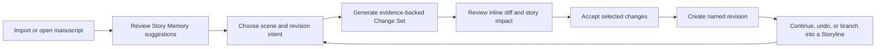

# openAuthor Product Development Plan

Status: canonical forward-looking product plan
Scope: product strategy, domain model, delivery sequence, release gates, and success measures
Engineering history: `docs/plan.md`

Current author-task assessment and iteration priorities: [Author journey readiness](author-journey-readiness.md).
The September 7 iteration adds chapter reading and a connected browser/engine
journey through import, planning, Memory, search, copilot notes and export. Future
iterations must advance whole writing tasks alongside safety fixes; feature
inventory and green unit tests alone do not establish a useful application.

### Current execution checkpoint — 2026-10-01

The [editorial workspace and recovery pass](evaluations/editorial-workspace-2026-10-01/review.md)
integrates remote main with the local authoring work. Continuity review now gives
paired evidence space in the main editor. Validated tabs, caret and scroll
positions return on restart; fresh source loading and guarded recovery preserve
newer writing. The eight original continuity challenge cases now match their
expected outcomes, with additional attribution and explicit-change regressions.
These focused local checks do not complete broader literary judgment. Next
evaluate supported findings, omissions and revision usefulness on a connected,
author-reviewed chapter, followed by packaged-GUI restart acceptance.

### September 29 checkpoint

Writing Voice now completes a smaller author-directed iteration: compare with
the saved original, give targeted feedback to one sample, retain the previous
attempt, then queue the chosen prose for ordinary Change Set review/apply/undo.
Refinement does not learn a profile or change prose automatically. Source/version
checks protect newer writing and other Storylines; unfinished feedback is retained.
See [Writing Voice](writing-voice.md) for usage and boundaries.

The [Luna dialogue followup](evaluations/writing-voice-luna-2026-09-29-dialogue/assessment.md)
produced three samples without the earlier added closing exchanges, but still
showed physical-staging and restraint weaknesses. This is a small uncontrolled
comparison, not proof of general literary improvement. A
[fresh-scene live refinement](evaluations/writing-refinement-luna-2026-09-29/assessment.md)
also verified apply/undo but only partial compliance with craft feedback. Next
assess these samples with the author, then a connected chapter and original-book
revision. The North Star is not marked complete: full-book usefulness, physical
companion testing, recovery and clean-machine distribution remain open gates.

### September 22 checkpoint

The [voice preflight and paired-test plan](evaluations/2026-09-22-voice-preflight.md)
now cover rendered voice controls with simulated media. A reproduced terminal
disconnect/playback failure left stale controls; the repair restores Start while
preserving the error and stopping media. Real phone audio and approved deployment
remain open. A nine-call subscription-only Luna run produced a
[comparison packet](evaluations/writing-voice-luna-2026-09-22/review.md) and
[assistant critique](evaluations/writing-voice-luna-2026-09-22/assessment.md).
Results are mixed, especially invented dialogue ending beats; author judgments
remain pending. Next: paired literary review, then an approved phone connection
and physical acceptance pass—not additional infrastructure or automatic rewrites.

The [author-workflow walkthrough](evaluations/2026-09-22-author-walkthrough.md)
now adds smaller-laptop and exploratory mobile navigation checks to the existing
connected journeys. It fixes lost unfinished captures on tab changes, lost
mobile reading focus/scroll, collapsed desktop document tabs, and voice status
hidden below long context explanations. Book exit/sign-out warn about unfinished
captures; draft/reading retention is in-memory, not crash recovery. No new
infrastructure was added. Browser coverage does not establish native or real-phone
voice behavior; actual companion delivery and useful writing remain the next gates.

The companion's reading flow now uses the desktop's existing manuscript-reading
projection. Newly published scenes follow Plan order with unassigned scenes at
the end, and retain act/chapter labels. Mobile supports Previous/Next, scene
position, chapter-name search and **Discuss this scene**. The existing voice
scene-list tool reports the same order and labels, explicitly distinguishing
reading order from story chronology. Older downloads retain their recorded order
until republished. This adds no mobile editing, new service or persistence layer;
mobile reading-position restoration across restarts remains separate work.

The mobile companion now receives the approved Writing Voice through the existing
encrypted snapshot and device-local context builder. Its Assistant shows the
downloaded profile, distinguishes manuscript style from speaking personality,
and explains the publish/reopen/restart cycle. Missing profiles in older snapshots
remain explicit. Required profile and selected-scene content must fit in full
before a voice transport is created; authors can clear scene focus to retry.
Local encrypted-publication/browser and controller tests cover this path, not
live-model quality, deployed hosting or physical-device audio.

Mobile snapshots also reuse desktop's privacy-filtered accepted Canon Facts.
New sessions receive scene-relevant facts (or all eligible facts with no scene
focus), including exact evidence, validity and character-knowledge states. The
phone reports the selected count and missing-source warnings. Withdrawals take
effect after publication and reopening, not retroactively in downloaded copies
or running sessions. Required facts are included whole or block connection when
over budget. This stays inside the existing snapshot/context workflow; chapter
synopses and Storyline intent, broader on-demand fact retrieval and real-device acceptance
remain separate work.

Canon Facts can now be corrected, withdrawn and restored in Canon & Continuity.
Authors can edit the value, predicate, validity boundaries and existing source
passages. Withdrawn facts remain inspectable but are excluded from newly assembled
canon context and fact-based diagnostics; earlier conversations are not rewritten.
Accepted corrections require exact passages in current saved scenes. Fact- and
Storyline-scoped version checks prevent stale corrections from overwriting newer
Memory, and the shared project lock protects concurrent Memory writers. This is
not semantic verification, a complete fact-history UI or crash recovery for drafts.

Canon & Continuity now connects findings to evidence and revision. Authors can
expand recorded passages on facts and diagnostics, open their scenes, filter
findings by attention/reviewed state, and save or revise a decision with notes.
Deferred findings stay in Needs attention. **Plan a revision** carries the finding
and the author's review notes into the existing editable Change Set form. Multiple
affected scenes require an explicit target choice. A review decision is not proof
that a check's underlying condition has been corrected.

The 64-scene browser journey now exercises a possible POV knowledge leak, early
and later source navigation, saved/reopened decisions, return to Needs attention,
and revision preparation with unchanged manuscript prose. Recorded evidence is
explicitly distinguished from verification against the current scene. This adds
usability to the existing deterministic checks; novel-scale judgment and broader
continuity detection remain unproven.

Saved Copilot ideas now connect back to writing: **View saved note** opens and
focuses the note in Plan. Notes sit near the brief, support text/scene search and
scene/project filtering, open their scene, and prefill an editable Change Set
request through **Plan a revision**. The author still chooses when to generate
and reviews the resulting changes. Existing note storage and proposal generation
are reused; no new backend, note schema or project mutation is added.

Refreshing a newly saved note keeps unfinished Plan drafts. Returning to an open
scene preserves its existing tab and guarded draft. The connected browser journey
now follows discussion → saved note → search → scene → editable revision request
→ pending Change Set, with unchanged prose before application. This addresses the
documented daily-writing gap of finding and acting on saved ideas.

Next prove actual companion delivery and useful editorial outcomes, followed by
recovery/distribution gates and observed accessibility friction. Do not let more
small context additions displace the deployment/device acceptance journey.
Keep choosing connected author tasks and reuse existing workflows before adding
new infrastructure.

### Previous execution checkpoint — 2026-09-13

The current sequence has completed the bounded Terra action-scene review,
proposal review/apply/undo browser coverage, and a more transparent chat context
receipt. The action packet preserves generated prose for author comparison while
keeping strict evidence validation in the evaluator. The proposal loop is
passing through real Python-backed browser journeys, including stale/conflict
handling and undo. Chat responses now identify the scope, scenes, nearby scenes,
selected passage and retrieved-evidence count used for the request.

The next product work remains end-to-end usefulness rather than another isolated
panel: verify Story Memory on a substantial manuscript, run the mobile companion
against a deployed gateway and real devices, and then close recovery,
accessibility, packaging and hosted-security gates. Local green tests and a PWA
build do not establish those external or physical-device outcomes.

## Approved working direction — 2026-09-07

The author accepted the recap and vision: a desktop studio trusted with the
manuscript, paired with a phone companion for reading, story-aware voice,
capturing ideas, and returning work for desktop review. This section is the
current execution sequence; older phase-completion statements below describe
implementation checkpoints, not present-day release certification.

We have enough feature breadth to pursue a useful novel-writing application.
Each iteration must complete an author task, address the bugs that obstruct it,
and verify the outcome. Do not replace product progress with an indefinite list
of isolated safety fixes or add standalone panels without a demonstrated need.

### Delivery sequence and acceptance evidence

1. **Finish the current assistant reliability checkpoint.** Complete assembled
   request budgeting, required-context preservation and understandable recovery
   when a request is too large. At resumption, the browser regression correctly
   rejects an oversized chapter and preserves the question, but an error banner
   blocks Send after switching to Scene scope. Finish that interaction, rerun
   targeted and broad checks, and record the exact evidence. Estimated input
   limits must not be presented as exact token billing or a session-wide voice
   spending guarantee.
2. **Prove a substantial-book editorial loop.** Use an original or authorized
   longer manuscript with deliberate continuity, pacing, character-knowledge and
   voice issues. Exercise chapter diagnosis, distant evidence, coordinated scene
   revisions, protected facts, alternate Storylines, selective integration and
   undo. Judge useful changes and preserved author intent, not just successful
   requests. Start with deterministic mechanics; agree on manuscript scope and
   a spending limit before live-provider evaluation.
3. **Deliver the mobile voice companion as a parallel product track.** The first
   acceptance journey is desktop connection/publication, opening the book on a
   real phone, scene-aware voice, interruption and reconnect, capture, and desktop
   review. PWA is the current first delivery candidate, not a substitute for
   physical iOS/Android testing. Assess the desktop-connected option below before
   making a new hosting commitment. Existing encrypted sync work remains intact.
4. **Improve daily writing continuity alongside those journeys.** Prioritize
   persistent reading position, retained Plan drafts, discoverable saved notes,
   clear pending-review state, keyboard/touch accessibility and recoverable
   errors. Select the next feature based on a demonstrated author obstacle.
5. **Complete release gates across both tracks.** Verify crash recovery,
   backup/restore, remaining storage races, hosted authorization where used,
   native credentials, physical-device audio, signed packaging and clean-machine
   installation. Passing local tests or building a PWA is not a release.

Beyond these milestones, connect existing diagnostics, Story Memory, character
arcs and setups/payoffs into a book-level revision plan: identify issues, let the
author prioritize them, review changes and track unresolved work. Full mobile
editing, collaboration, marketplace features and publishing/typesetting remain
outside the first companion delivery.

### Mobile option to evaluate: connection to a running desktop

The author suggested a remote companion that relies on a running desktop, perhaps
through an integrated Tailscale connection. ChatGPT and T3Code were mentioned as
possible examples; their exact architectures have not been verified here and
must not be cited as established implementation evidence.

This is an option for evaluation, not approval to install Tailscale, expose a
desktop service, deploy hosting or replace the existing sync implementation.
The subsequent [first-party source evaluation](research/desktop-connected-mobile.md)
verifies T3 Code's running-host/pairing/Tailscale HTTPS pattern; the ChatGPT
analogy remains unverified. The research recommends a bounded loopback-only
context/capture bridge experiment, preserving encrypted offline reading/capture,
before any separately authorized real-device network exposure. This is a test
candidate, not a decision to replace the current architecture.
Compare three candidates against the same real-phone acceptance journey:

- Current encrypted-snapshot companion with a hosted voice-session gateway.
- Live desktop-connected companion with authenticated, narrowly scoped access
  to desktop context and assistant services.
- A hybrid that uses a live desktop when available and downloaded reading/capture
  when it is not.

Evaluate onboarding effort, desktop sleep/offline behavior, network switching,
HTTPS and microphone permissions, phone latency, device revocation, key handling,
distribution requirements and operational cost. Distinguish desktop-owned
context/tools from model inference: desktop connection does not imply that a
cloud voice model runs locally. Private network reachability alone must not be
treated as authorization to a book or to manuscript-changing actions.

Before choosing, inspect first-party documentation/source and test a bounded
connection prototype if needed. Prefer the option that gives the author a
reliable read/talk/capture/handoff experience with the least operational burden.
Keep the manuscript desktop-reviewed in every option, make desktop availability
visible, and preserve captured work during disconnects. Hosting or network
exposure requires a separate explicit decision.

### How to resume and report progress

The first reliability checkpoint has now passed its focused browser regression:
required chapter input is rejected without losing the question, Scene retry keeps
complete focused prose, and notifications/onboarding no longer cover controls.
Assembled-input estimates and later text-tool rounds have focused core coverage.
See the dated input-budget entry in `production-readiness.md` for broad results
and remaining limits. Next advance the substantial-book editorial journey while
evaluating mobile connection options before a new hosting commitment.

The next pass added a [36,476-word mechanical editorial workload](editorial-workload.md)
and verified distant citations, protected coordinated application and per-scene
undo. It fixed late composer initialization, stale proposal-tab identity and
group-apply review state, plus a local fallback comparison-phrase error. This
does not complete non-templated manuscript/editorial-quality validation. Useful
next author tasks are explicit group undo and retained review/reading state,
alongside the non-templated exercise and bounded mobile bridge candidate.

The September 11 pass delivers explicit coordinated undo. Changes lists the
affected scenes and restores the recorded group in one action and one new
Revision. The shared engine refuses newer scene-file changes, partial prior
undo, missing records and a changed Storyline before restoring anything. The
64-scene browser journey now uses group undo, with a separate real-core browser
case protecting newer author writing. Older groups without recorded undo scope
retain individual review; this is not multi-file crash recovery. Next prioritize
retained reading position and unfinished review/Plan drafts alongside the
non-templated editorial exercise and bounded mobile companion experiment.

Read this section and `author-journey-readiness.md` at resumption. Use
`production-readiness.md` for dated verification history and
`voice-mobile-build-plan.md` for implementation architecture. Report implemented,
locally verified, real-device verified and release-certified states separately.
Keep known failures visible; do not overwrite historical evidence with newer
test counts or claim a full regression run covered edits made after it started.

### Approved Writing Voice extension — 2026-09-11

The author requested more control over copilot writing quality and approved the
Writing Voice workflow. This is now implemented: an editable per-book profile,
three original craft presets, review-first interpretation of author-selected
exemplars and natural-language briefs, shared manuscript-prose guidance, and
short two/three-direction comparisons with explicit author quality assessments.
Selecting a sample queues an ordinary Change Set; neither analysis nor comparison
automatically changes the approved voice, canon or manuscript. The copilot's
conversational personality is separate from manuscript prose style.

See [Writing Voice](writing-voice.md) for the workflow, bounds, persistence,
provider/local differences and verification. The shared projection reaches text
copilot, desktop voice preparation, planning, whole-scene drafting, hunk revision
and merge generation. The September 22 mobile snapshot/context adapter now carries
the approved projection too; publishing and reopening are required to refresh it.
Generic presets express craft traits, not author imitation.

Next pair this workflow with the non-templated editorial-quality exercise: compare
short original scenes, judge character distinction and intended emotional effect,
and verify preserved facts separately from prose preference. Existing local and
provider-seam tests establish workflow mechanics and supplied instructions, not
literary quality. Live evaluation needs agreed manuscript scope and spending.
Keep retained reading/review/Plan state and the bounded companion experiment in
the next delivery sequence; do not replace them with more style controls before
testing whether these controls produce useful writing.

### Session continuity and quality evaluation — 2026-09-12

Implemented the approved reading/Plan/assessment recovery work through one local
working-copy journal. Reading restores a scene-relative position; Plan preserves
unfinished brief, structure and metadata fields; Writing Voice preserves unsaved
ratings/notes. Book/Storyline scoping and original-value save checks keep recovered
drafts from silently overwriting newer saved work. The connected browser test also
found and fixed a delayed first-scene navigation taking focus from the reader.
See [session continuity](session-continuity.md).

The [writing-quality evaluation](writing-quality-evaluation.md) now uses three
original action/dialogue/introspection scenes, nine anonymous samples, explicit
fact checks and separate human craft judgments. The existing subscription
connector is reused. The author allows only ChatGPT subscription usage, otherwise
offline—not API-key providers. OpenAuthor's own account check was unauthenticated,
so the actual run was offline and produced unchanged baselines; no literary
improvement is claimed. The craft prompt is more explicit, but its generated
results still need a subscription run and author review. Review the saved
[baseline packet](evaluations/writing-voice-local-2026-09-12/review.md) and
[keyed record](evaluations/writing-voice-local-2026-09-12/record.json).

The author subsequently signed in and approved Luna or Terra. Both were returned
by the existing subscription runtime; the live exercise explicitly used Terra.
It found a presentation-quote validation bug and a runner partial-result loss bug,
now repaired with regressions. The final bounded run accepted six dialogue and
introspection candidates, while action still failed validation. See the
[live assessment and remaining limits](evaluations/writing-voice-terra-2026-09-12-attempt-3/assessment.md).
Generated variations are modest, and semantic slips can survive lexical checks;
no general writing-quality claim or automatic learning is justified.

Next: capture and resolve the remaining rejected-result case and obtain the
author's blind preferences on the saved samples; then
advance the bounded desktop-connected mobile companion experiment and remaining
mobile context parity. Do not add more voice controls on the assumption that
workflow tests prove the current ones produce good prose. Recovery here is local
working-copy continuity, not cross-device sync or durable crash transactions.
**Evaluation evidence boundary, September 2026**

All 1.0 scores and zero-error Editorial/Canon claims below refer only to the small deterministic regression corpora: Editorial uses the local adapter and pattern/term checks, while Canon starts with manually supplied facts. They do not establish manuscript extraction accuracy, preservation of author voice, or live-provider editing quality. The consent-gated workflow in `docs/author-evaluation-and-pilot.md` adds real import/review/apply/undo/recovery measurement, but current runs are synthetic and no author pilot or live manuscript evaluation is approved. The July verification record is historical, not a current release certification.

## Delivery status

Phase A is complete and Phase B is implementation-complete but not release-certified. The repository has a validated capability registry, an honest active-V2 documentation boundary, a deterministic 400-scene scale fixture with enforced budgets, a rendered React workflow contract, a native Tauri-to-core golden-loop gate, and a strict on-device product-signal schema with a private activation/trust dashboard. Phase B has delivered staged Markdown/TXT/DOCX/Scrivener import, structure preview, Markdown/DOCX export with loss reporting, crash-recovery journaling, startup health with guided safe repair, a first-safe-revision guide, and a checksum-pinned Python runtime verified inside a real macOS application bundle. Safe proposal apply/undo and retrieval freshness use an internal content-addressed Revision store, so the golden loop does not require system Git; Git is reserved for the Storyline adapter. Developer ID credentials, Apple notarization evidence, both-architecture clean-machine validation, and automated packaged-GUI execution are external release gates, so no visible capability is labeled release-ready. Current truth lives in [`capabilities.json`](capabilities.json) and [`capabilities.md`](capabilities.md).

Phase C is implemented in the active product. The Changes surface creates concrete Change Sets in one action, groups deterministic hunks, supports include/exclude review, direct editing, regeneration, and author-comment revision, carries constraints and protected elements, blocks protected-text violations, safely rebases uniquely matching passages, previews evidence-backed Story Memory impact, applies selected prose atomically, and supports coordinated multi-scene groups as one reversible Revision. Immutable history, comparison, selective restore, one-click undo, and intent-aware retrospectives are active. Packaged GUI automation remains the release gate.

Phase D's competitive authoring baseline is implemented in the active product. The Plan workspace stores the project synopsis, genre, themes, style guide, outline, act/chapter hierarchy, scene placement, scene beats, story-time positions, and labels in `manuscript/structure.json`; it shows a Character Arc overview and previews act, chapter, order, and story-time consequences before a drag move is committed. Story Memory entries support typed details, aliases, tags, categories, notes, AI visibility, book/series scope, explicit temporal relationships, author correction, and bulk accept/defer/exclude. A project-wide Connection Map spans characters, places, lore, items, factions, and events; it visualizes only accepted relationships and keeps prose-found links in an evidence-backed review queue. Import prepares evidence-linked suggestions that remain non-canon until accepted, search spans prose, summaries, planning, and structured Memory, the Change Set composer includes reusable built-in and custom Editorial Passes, and Assistant messages expose context hints and source citations. Rendered coverage now includes Plan metadata, Story Memory correction and bulk review, and the relationship acceptance boundary; search and Pass-selection automation remain product gates, so Phase D is implemented but not release-ready.

Phase E has an evidence-backed Canon foundation in the active product. `codex/memory.json` stores temporal Canon Facts, manuscript evidence, confidence, book/series scope, character knowledge/belief state, setups/payoffs, open questions, Character Arc states, and remembered diagnostic dispositions. Explicit relationships can change over scene ranges. Deterministic extraction recognizes a deliberately narrow set of explicit named relationship statements, cites the exact scene passage, and proposes rather than applies the connection; co-occurrence alone never creates a link. Deterministic and affected-scene diagnostics surface overlapping conflicting facts, impossible validity ranges, possible POV knowledge leaks, unresolved setups, arc conflicts, and planned/observed arc divergence with source passages; Change Sets preview affected Canon Facts and setup/payoff anchors, while imports, scene saves, accepted changes, and Assistant promotions create reviewable suggestions rather than silently changing canon. The committed seven-scenario corpus includes temporal change, impossible ranges, unreliable narration, long-running setups, intentional mysteries, series-scoped facts, and arc-state conflicts at 1.0 measured precision and recall. Broader design-partner genre data remains a release-readiness gate.

Phase F has replaced raw branch creation as the default experiment workflow. The active Storylines space creates a named experiment from the trusted manuscript with a hypothesis, scope, success criteria, and protected constraints; it saves progress automatically when returning, compares scenes, word count, arcs, Canon Facts, setups, and open questions, and gives a deterministic pre/post impact summary. The Change Set composer can generate one coordinated AI revision across selected scenes on the active Storyline; each scene remains independently reviewable and the group applies atomically as one reversible Revision. Authors can also select existing Storyline changes to translate into ordinary hunk-reviewable Changes on the primary manuscript. Storylines can be entered, saved, renamed, duplicated, archived, restored, and compared without Git vocabulary, while the adapter remains in Diagnostics. Core and rendered tests cover alternate-ending creation, coordinated generation, comparison, return, and integration. Packaged workflow automation remains open.

Phase G's durable editorial workflow is implemented in the active product. The composer includes built-in and author-defined Editorial Passes, author-selected Style Profiles, one or three intentionally different creative directions, and outcome-centered comparisons across voice shape, scope, Story Memory impact, and Canon risk. Assistant conversations have explicit Book, Scene, Chapter, Character, and Storyline presets, and outputs promote into Change Sets, review-first Story Memory suggestions, visible notes, or Storyline experiments instead of dying in chat. Revision History includes intent-aware retrospectives that summarize changed scenes, accepted hunks, Story Memory movement, and remaining continuity goals. The committed seven-genre evaluation exercises every built-in Pass, measures 1.0 targeted issue reduction, and reports zero protected-term or introduced-name canon errors. Automated rendered coverage for every promotion and comparison variant remains a release-hardening gate rather than a missing product surface.

Phase H is partially activated by the author's explicit roadmap decision. A mobile
companion with voice is now a current requirement, not a retention-gated future
candidate. It supports reading, story-aware conversation, capture, and desktop
review, with opt-in encrypted sync and hosted voice. The first accessible delivery
path is an installable browser/PWA experience sharing the native companion's
domain logic and interface. Full mobile manuscript editing, collaboration, and
broader hosted services remain deferred. See `voice-mobile-build-plan.md` for the
active scope and `production-readiness.md` for evidence and remaining gates.

### Implementation verification record

The 2026-07-15 completion audit produced the following evidence against the active product:

- 117 Python tests and 86 rendered desktop tests pass.
- Six native Rust tests pass, including the real Tauri-to-bundled-core project/scene/proposal/apply/undo path and the private-metrics bridge contract.
- The production desktop build, macOS `.app` bundle verification, bundled Python 3.11 arm64 runtime check, and dependency audit pass.
- The 400-scene scale fixture meets every startup, load, search, save, and analysis budget.
- The seven-scenario Canon corpus measures 1.0 precision and 1.0 recall.
- All seven built-in Editorial Pass tasks improve their targeted pattern with zero protected-term or introduced-name canon errors.
- A native packaged-app pass verified semantic keyboard navigation, Plan metadata, Story Memory correction/bulk review, private dashboard loading, coordinated two-scene Change Set generation, and per-hunk comment revision.

These results establish implementation completeness for the single-author product. They do not substitute for Apple credentialed distribution, clean-machine certification, or evidence that serious authors retain and pay for the workflow.

## North star

> An AI assistant for novel writing that treats writing a novel like software engineering, allowing continuous iteration and experimentation with revision history and creative suggestions.

openAuthor should make the safety and leverage of software development available to novelists without forcing them to understand developer tooling.

The author-facing promise is:

> A private story studio that remembers the canon, proposes reviewable changes, and lets an author explore any creative direction without losing the version they trust.

## Product thesis

Most AI writing products optimize for generating more text. openAuthor should optimize for making consequential changes to a long, evolving manuscript with confidence.

The winning wedge is not generic drafting. It is **safe revision of complex fiction**:

- understand an existing manuscript and its story world
- suggest changes grounded in manuscript evidence
- show exactly what would change and why
- accept, reject, or reshape changes at a granular level
- preserve every meaningful revision
- explore alternate story directions without corrupting the main manuscript
- detect continuity consequences across scenes, books, and character arcs

The engineering model is an implementation advantage, not the primary user vocabulary. Authors should see Changes, Revisions, Story Memory, and Storylines—not commits, hashes, indexes, and merge machinery unless they deliberately open Diagnostics.

## Initial market wedge

### Primary user

A serious independent or traditionally published fiction author who:

- has an existing manuscript or series rather than only a blank-page idea
- revises repeatedly and experiments with structure, character motivation, or endings
- manages enough world and character complexity that continuity becomes costly
- wants AI assistance but is uncomfortable surrendering control, voice, or intellectual property
- values durable local files and the ability to use more than one model provider

### First high-value jobs

1. **Revise this scene without flattening my voice or breaking canon.**
2. **Tell me what this change affects elsewhere in the manuscript.**
3. **Let me explore a major alternative and safely compare it with the current story.**
4. **Help me remember what is true, when it became true, and who knows it.**
5. **Let me recover any earlier version without fear.**

### Expansion users

After the single-author workflow is excellent:

- series authors sharing canon across books
- author/editor collaboration
- co-authors
- writers' rooms
- interactive-fiction and game narrative teams

Team SaaS is an expansion path, not a prerequisite for proving the core product.

## Product principles

### 1. The manuscript is the source of truth

Story Memory must cite the passages that support a fact. AI-generated interpretations remain suggestions until accepted by the author.

### 2. AI produces change sets, not silent mutations

Every manuscript-changing action creates a reviewable Change Set. The author can accept all, accept selected changes, edit the result, reject it, or return later.

### 3. Every important operation is reversible

Saving, applying AI changes, importing content, editing Story Memory, and integrating a Storyline all create named revisions that can be inspected and restored.

### 4. Exploration is cheap; commitment is deliberate

Authors should be able to create an alternate Storyline in seconds. Returning changes to the primary manuscript should require an understandable review, not raw version-control expertise.

### 5. Intelligence must be explainable

Continuity warnings, editorial suggestions, and generated changes show evidence, confidence, scope, and the reasoning category that produced them.

### 6. Local-first is the default

The manuscript, Story Memory, revision history, and derived indexes work without a hosted account. Cloud sync, collaboration, and hosted inference are optional services.

### 7. Advanced controls stay available but recede from the main workflow

Provider configuration, model settings, token budgets, generation runs, retrieval indexes, and git details live in Advanced or Diagnostics surfaces. The default experience speaks in author goals.

## Competitive baseline and differentiation

openAuthor should adopt proven author expectations without copying a competitor's product structure.

### Baseline capabilities to implement well

- manuscript import and export
- acts, chapters, scenes, and beats
- synopsis, genre, themes, style guide, outline, characters, locations, lore, factions, items, and events
- structured Codex fields, tags, aliases, relationships, notes, and AI visibility controls
- automatic manuscript-to-Codex suggestions after import
- contextual chat with explicit control over included material
- reusable editorial instructions or “passes”
- version history and restoration
- series-level Story Memory
- fast manuscript-wide search
- model/provider choice

### Where openAuthor must be meaningfully better

| Area | Baseline expectation | openAuthor differentiation |
| --- | --- | --- |
| AI edits | Generate or replace prose | Evidence-backed Change Sets with per-hunk acceptance and named revisions |
| Story bible | Descriptive reference cards | Temporal Story Memory with facts, evidence, POV knowledge, relationships, and validity ranges |
| Continuity | AI or rule-based warnings | Reproducible diagnostics that identify the conflicting claims and affected scenes |
| Version history | Restore an earlier field or scene | Project-wide revisions with meaningful change summaries and safe restore |
| Alternate drafts | Duplicate documents or novels | Storylines with an experiment brief, impact analysis, comparison, and selective integration |
| AI context | Automatic or prompt-configured context | Inspectable Context Pack with citations, inclusion controls, and staleness state |
| Data ownership | Export from a hosted product | Human-readable local project that remains useful without openAuthor |
| Model choice | Select a provider/model | Provider independence plus comparable, reproducible generation provenance |

### Features not worth copying directly

- a broad plugin marketplace before the core editing loop is trusted
- dozens of model and sampling controls in the default UI
- generic chatbot behavior disconnected from manuscript changes
- one-click full-chapter generation as the primary value proposition
- gamified word generation that rewards volume over manuscript quality

## The golden loop

The golden loop is the first workflow that must feel complete, fast, and safe.

### Golden-loop experience requirements

1. **Open or import**
   - Start a new novel or import Markdown, plain text, DOCX, and supported Scrivener content.
   - Preserve headings and infer acts, chapters, and scenes for review.
   - Never modify the source import.

2. **Understand**
   - Build an initial Story Memory as suggestions.
   - Show the author what was inferred and the passages used as evidence.
   - Allow bulk approval, correction, deferral, and exclusion.

3. **State an intent**
   - Select a scene, passage, chapter, character arc, or Storyline.
   - Choose or write an editorial goal such as tighten pacing, deepen motivation, repair continuity, or explore an alternative.

4. **Propose**
   - Produce a concrete Change Set in one operation.
   - Include the proposed prose, affected Story Memory, relevant citations, estimated scope, and cost before application.
   - An optional planning step may exist for large changes but should not be mandatory for ordinary scene revision.

5. **Review**
   - Render side-by-side and inline diffs.
   - Group changes into meaningful hunks with short rationales.
   - Support accept/reject per hunk, direct editing, regenerate-hunk, and comment-for-revision.
   - Flag contradictions introduced or repaired by the proposed text.

6. **Commit**
   - Apply selected hunks atomically.
   - Create a named Revision with intent, author/AI attribution, affected artifacts, and provenance.
   - Offer immediate undo and compare-to-before.

7. **Iterate or experiment**
   - Continue revising on the current Storyline.
   - Create a new Storyline when the idea changes story structure, character arcs, or multiple scenes.

## Product information architecture

The default application should have six author-facing spaces.

### Write

- manuscript tree: act → chapter → scene
- focused scene editor
- inline AI suggestions and Change Set review
- scene metadata and beats in Inspector
- distraction-free mode

### Plan

- outline and corkboard
- acts, chapters, scenes, beats, POV, status, timeline position, and labels
- drag/reorder with a preview of structural consequences
- synopsis, themes, and character-arc overview

### Story Memory

- entities, facts, relationships, timeline, setups/payoffs, and open questions
- manuscript evidence for every accepted fact
- suggestion inbox for newly inferred or conflicting information
- project- and series-level scopes

### Changes

- pending Change Sets
- inline review and partial acceptance
- named Revision history
- compare, restore, and undo
- continuity impact attached to each change

### Storylines

- primary Storyline plus named experiments
- experiment brief and hypothesis
- differences by scene, arc, fact, and word count
- integration workflow expressed as Change Sets

### Assistant

- manuscript-aware conversation
- visible context chips and citations
- reusable editorial passes
- promote an answer to a Change Set, Story Memory suggestion, scene note, or Storyline experiment

### Advanced / Diagnostics

- provider credentials and model defaults
- generation history and raw provenance
- token/cost policy
- retrieval and Story Memory index health
- workspace repair and performance reports
- underlying revision-control details

## Domain model evolution

The current scene, Codex, proposal, generation, and branch primitives remain useful, but the product requires richer domain objects.

### Manuscript structure

- **Series**: optional container for shared Story Memory and multiple books
- **Project / Book**: versioned authoring workspace
- **Act**: optional structural grouping
- **Chapter**: ordered container for scenes
- **Scene**: prose plus summary, POV, status, intent, time, location, and beats
- **Beat**: planned or realized story event within a scene

### Story Memory

- **Entity**: character, location, organization, faction, item, lore, event, or author-defined type
- **Entity Detail**: typed, author-configurable field with visibility and series/project scope
- **Alias**: alternate entity name with matching controls
- **Relationship**: directional relationship between entities, optionally time-scoped
- **Canon Fact**: atomic claim accepted as true by the author
- **Evidence**: scene range or author note supporting a fact
- **Validity Scope**: when a fact becomes true, changes, or stops being true
- **Knowledge Scope**: which characters know or believe a fact at a point in the story
- **Setup / Payoff**: linked narrative promise and resolution
- **Open Question**: deliberately unresolved uncertainty that should not be treated as a contradiction

### Change management

- **Change Set**: proposed change to one or more versioned artifacts
- **Change Hunk**: independently reviewable unit within a Change Set
- **Revision Intent**: goal, constraints, protected elements, and desired scope
- **Impact Report**: affected facts, scenes, arcs, setups/payoffs, and risk level
- **Revision**: immutable record of accepted changes and their before/after state
- **Restore Operation**: a new Revision that returns selected artifacts to an earlier state

### Storyline experimentation

- **Storyline**: named line of development backed by a branch
- **Experiment Brief**: hypothesis, protected constraints, intended scope, and success criteria
- **Storyline Delta**: semantic comparison of manuscript and Story Memory changes
- **Integration Plan**: selected Storyline changes translated into reviewable Change Sets

### Assistant intelligence

- **Context Pack**: ordered, inspectable set of manuscript and Story Memory evidence used for a model call
- **Editorial Pass**: reusable instruction, context policy, output contract, and evaluation criteria
- **Suggestion**: non-mutating recommendation for prose, structure, or Story Memory
- **Diagnostic**: evidence-backed finding with severity, confidence, and disposition
- **Disposition**: accepted, fixed, dismissed, intentional, or deferred feedback used to reduce repeated false positives

## Storage and architecture direction

### Storage classes

| Class | Examples | Versioned | Rule |
| --- | --- | --- | --- |
| Author source | scenes, outline, Story Memory snapshots, project settings | yes | Human-readable and portable |
| Review artifacts | Change Sets, comments, impact reports | yes by default | Needed to explain accepted revisions |
| Runtime stores | SQLite projections, caches | no | Rebuildable from author source |
| Derived intelligence | lexical/semantic indexes, embeddings, summaries | no | Must record source digest and staleness |
| Operational telemetry | generation logs, diagnostics bundles | configurable | Private by default with retention controls |

### Core boundaries

Create explicit core services rather than continuing to grow central modules:

- `manuscript` — hierarchy, scene content, import/export
- `story_memory` — entities, facts, evidence, timeline, knowledge, relationships
- `changes` — Change Sets, hunks, apply/reject, impact, revisions
- `storylines` — branch lifecycle, comparison, integration
- `assistant` — context packing, provider calls, tools, editorial passes
- `diagnostics` — continuity, quality, workspace health, performance
- `projects` — identity, migrations, series, local/cloud bindings

Each service should expose a versioned command/query contract. Generate TypeScript types or JSON Schema from the contract rather than hand-maintaining frontend response types.

### Desktop evolution

- Split the current workspace-wide state into bounded stores aligned with the services above.
- Use query caching and invalidation instead of refreshing every resource after an action.
- Move long-running import, Story Memory extraction, indexing, and manuscript analysis to cancellable jobs with progress events.
- Keep the Python core while workflows stabilize; do not rewrite capabilities in Rust solely for architectural cleanliness.
- Use Rust/Tauri for packaging, filesystem integration, secure credential storage, process supervision, and OS-specific behavior.

### Model strategy

- Preserve provider choice.
- Define task-level model capabilities rather than scattering model names through UI code.
- Use deterministic local/rule-based logic for identity, versioning, evidence links, diffing, and application.
- Use LLMs for interpretation, suggestion, summarization, prose generation, and candidate fact extraction.
- Require structured outputs for Change Sets, facts, diagnostics, and impact reports.
- Add semantic retrieval only after the Story Memory schema and evaluation corpus exist. Embeddings are an implementation detail, not a roadmap outcome.

## Delivery roadmap

Delivery is organized around product outcomes. A phase is complete only when its workflow exists in the active shell, passes a native end-to-end test, and meets its exit criteria.

### Phase A — Truthful baseline and product gates

Objective: make repository status correspond to the active product.

Deliverables:

- capability registry with `core`, `active UI`, `end-to-end verified`, and `release-ready` states
- reconcile README, runbook, architecture, and roadmap claims
- remove, finish, or hide placeholder and parity-gap surfaces
- replace the narrow placeholder-marker scan with explicit active-shell capability tests
- native Tauri end-to-end harness for project creation/open, scene edit, proposal, apply, and undo
- realistic large-project fixture with multiple books, 300–500 scenes, Codex entities, proposals, and generation history
- documented performance budgets for startup, project load, scene open/save, search, and analysis

Exit criteria:

- no visible feature is represented as complete without an end-to-end path
- CI distinguishes unit/build health from product-flow health
- the canonical plan and current status agree

### Phase B — Install, import, and trust the files

Objective: a non-developer can begin with a real manuscript.

Deliverables:

- bundled Python runtime and supervised sidecar
- signed/notarized macOS installation and update path
- startup health check and guided repair
- import for Markdown folders, TXT, DOCX, and Scrivener Draft binders with fixture-backed order and RTF prose extraction
- structure-detection review before imported content is committed
- export to Markdown and DOCX with a loss report
- crash-safe autosave, recovery journal, and restore-on-relaunch
- first-run tour centered on import → safe revision, not on project plumbing

Exit criteria:

- clean-machine install requires no Python, Node, Rust, terminal, or access-token knowledge
- an imported copy can be exported without losing prose or manuscript order
- a failed import leaves the original and project state untouched

### Phase C — Trusted Change Sets and the golden loop

Objective: make AI revision visibly safer and more useful than copying text from a chatbot.

Deliverables:

- replace plan-then-draft as the default with one concrete Change Set action
- optional planning checkpoint for multi-scene or structural changes
- stable Change Set and Change Hunk schemas
- semantic hunk grouping on top of deterministic text diffing
- inline and side-by-side review
- accept/reject/edit/regenerate per hunk
- protected text and constraints such as preserve voice, tense, facts, or quoted language
- staleness handling that can rebase unchanged hunks and explain conflicts
- named Revision created for every accepted Change Set
- compare, undo, and selective restore
- impact preview for affected scenes and Story Memory

Exit criteria:

- the complete golden loop works in the active desktop shell
- applying no prose changes cannot be represented as an applied manuscript edit
- partial acceptance produces a deterministic manuscript result and revision record
- every applied AI change can be traced to intent, context, model, and accepted hunks

### Phase D — Authoring foundation and competitive baseline

Objective: provide the planning and reference tools authors reasonably expect.

Deliverables:

- act/chapter/scene/beat hierarchy with drag-and-drop ordering
- synopsis, genre, themes, style guide, and outline
- typed entity details, aliases, tags, categories, notes, and AI visibility
- explicit relationships between entities
- project- and series-scoped entries
- automatic entity/detail suggestions from imported prose
- suggestion review queue rather than silent Codex population
- fast search across scene prose, summaries, notes, and Story Memory
- reusable Editorial Passes for common revision jobs
- inspectable Assistant context controls and citations

Exit criteria:

- an author can plan and revise a novel without maintaining story structure in another application
- imported suggestions are reviewable and never silently become canon
- the assistant can explain which Story Memory and manuscript sources it used

### Phase E — Real Story Memory

Objective: turn the Codex from reference cards into evidence-backed narrative memory.

Deliverables:

- Canon Facts with evidence, confidence, author status, and validity scope
- relationship evolution across the manuscript timeline
- character knowledge and belief tracking by scene
- setup/payoff and open-question tracking
- automatic candidate extraction after scene saves and accepted Change Sets
- contradiction detection showing both claims and their evidence
- timeline diagnostics and impossible ordering detection
- POV knowledge-leak diagnostics
- unresolved setup and arc-state diagnostics
- dispositions for intentional contradictions, unreliable narrators, mysteries, and false positives
- incremental recomputation limited to affected scenes and facts
- series-level Memory with per-book validity

Exit criteria:

- the system detects a curated corpus of cross-scene contradictions with measured precision and recall
- every diagnostic links to evidence and supports an intentional/dismissed disposition
- accepted manuscript changes update or propose updates to affected Story Memory
- repeated false positives decline as author dispositions accumulate

### Phase F — Storylines, not branches

Objective: make large creative experiments safe and understandable.

Deliverables:

- create Storyline from the current revision with a plain-language experiment brief
- Storyline dashboard with status, intent, last activity, and divergence summary
- semantic comparison across scenes, arcs, facts, timeline, setups/payoffs, and word count
- assistant-generated impact analysis before and after an experiment
- generate coordinated multi-scene Change Sets inside a Storyline
- integrate selected scenes or hunks into the primary Storyline
- translate conflicts into author-facing choices and Change Sets
- archive, duplicate, rename, and restore Storylines
- keep underlying Git available in Diagnostics without requiring Git vocabulary

Exit criteria:

- an author can explore an alternate ending across multiple scenes and integrate only chosen changes without using Git terminology
- Story Memory remains isolated per Storyline until integration
- all Storyline integrations are reviewable and reversible

### Phase G — Editorial intelligence and creative workflows

Objective: become a durable editorial partner rather than a generic chat surface.

Deliverables:

- Editorial Pass library: pacing, dialogue, motivation, prose clarity, tension, POV, setup/payoff, sensitivity prompts, and custom passes
- author-defined Pass builder with readable inputs rather than a programming language
- manuscript-, chapter-, character-, and Storyline-scoped assistant conversations
- turn outputs promotable to Change Sets, Story Memory suggestions, notes, or experiments
- alternative generation with meaningful comparisons: voice fit, canon risk, scope, and editorial intent
- project-specific style profile based on author-selected exemplars
- revision retrospectives summarizing what changed and which goals remain

Exit criteria:

- Editorial Passes produce measurable improvement on the evaluation corpus without materially increasing canon errors
- chat is not a dead-end: every useful result can become a durable project artifact
- author-facing comparisons prioritize creative outcomes over model telemetry

### Phase H — Optional cloud, collaboration, and additional surfaces

Objective: expand distribution and collaboration without weakening local ownership.

Candidate deliverables, activated only after single-author retention is demonstrated:

- encrypted opt-in project sync
- author/editor review roles and comments
- co-author change attribution and integration workflow
- writers' room Story Memory governance
- hosted model gateway and team cost controls
- read-only mobile Story Memory and capture companion, followed by mobile editing if demand supports it
- backup and device recovery that never becomes required for local use

Exit criteria:

- local projects remain fully usable without a subscription or network
- sync conflicts use the same Change Set and Storyline review model
- collaboration has explicit ownership and canon-approval rules

## Completed 90-day build sequence

This sequence is retained as the implementation history for the plan. Its repository-scoped work is complete; the remaining work moved into release certification and design-partner validation rather than another feature phase.

### Weeks 1–2: establish truth

- build the capability registry
- revise status claims and hide incomplete active-shell surfaces
- define the golden-loop event model and Change Set contract
- add the native end-to-end test skeleton
- create the large-series fixture and performance budgets

### Weeks 3–6: activation and installability

- bundle and supervise the Python runtime
- complete clean-machine install testing
- implement Markdown/TXT import and structure review
- add startup health and recovery UI
- instrument local, privacy-preserving product events for activation metrics

### Weeks 7–12: first complete golden loop

- implement concrete Change Sets and deterministic hunks
- build inline diff review with partial acceptance
- create named Revisions and one-click undo
- attach provenance and initial impact reporting
- ship the full workflow behind a product-preview flag to design partners

The sequencing rule still applies to Phase H: do not fund cloud breadth before design partners reliably complete and understand the golden loop.

## Next validation runway

1. Produce signed and notarized arm64 and x86_64 artifacts through the credentialed release workflow.
2. Run clean-machine installation, forced-termination recovery, import/export, and packaged golden-loop scripts on both architectures.
3. Recruit a narrow cohort of serious revising novelists with manuscripts already in progress; avoid blank-page users as the initial sample.
4. Observe time to first reviewed Change Set, correction behavior, evidence-panel use, apply/undo confidence, and four-week manuscript retention.
5. Improve the golden loop and Story Memory false-positive handling from observed friction before considering Phase H.
6. Treat willingness to pay for safe revision and Storyline experimentation—not raw generated word count—as the commercial decision gate.

## Quality and evaluation strategy

### Product test pyramid

1. **Core unit tests** for parsing, storage, diffing, migrations, and deterministic rules.
2. **Contract tests** generated from versioned command/query schemas.
3. **Workflow integration tests** using realistic project fixtures and real filesystem state.
4. **Desktop component tests** for author-visible states and error recovery.
5. **Native end-to-end tests** for the golden loop and release-critical workflows.
6. **Manual design-partner scripts** for subjective comprehension, trust, and creative quality.

### AI evaluation corpus

Build a licensed or internally authored corpus containing:

- short and long scenes in multiple genres and POV styles
- known character, timeline, world-rule, and knowledge contradictions
- intentional contradictions and unreliable narration
- style-preservation revision tasks
- multi-scene revision tasks with known affected facts
- alternate-ending Storyline experiments

Evaluate:

- instruction adherence
- voice and tense preservation
- factual consistency
- minimality of changes
- evidence correctness
- continuity precision and recall
- false-positive rate
- successful structured-output recovery
- cost and latency at realistic manuscript sizes

Model upgrades cannot ship solely because prose samples “look better.” They must pass the regression corpus and remain compatible with Change Set contracts.

### Release gates

A release candidate requires:

- all current unit, contract, build, and Rust checks green
- native golden-loop end-to-end test green
- import/export round-trip fixtures green
- migration tests from every supported project schema green
- large-project performance budgets met
- no visible placeholder or unimplemented action
- restore and crash-recovery drills completed
- manual smoke on a clean supported macOS machine
- known limitations documented in product language

## Product measurement

Telemetry must be opt-in, privacy-preserving, and content-free by default. Local dashboards should remain available even when external telemetry is disabled.

### Activation

- median time from install to first manuscript opened or imported
- median time to first Change Set reviewed
- percentage of new projects completing apply-and-undo within the first session
- import completion and abandonment rates by format

### Trust and usefulness

- Change Set acceptance, partial-acceptance, edit-before-accept, and rejection rates
- percentage of applied changes later undone or restored
- average accepted hunks per Change Set
- provenance and evidence-panel open rate
- number of sessions ending with a named Revision

### Story Memory quality

- suggestion approval and correction rates
- diagnostic accepted/fixed/dismissed/intentional rates
- false-positive rate by diagnostic type
- evidence-link correction rate
- time from manuscript change to reconciled Story Memory

### Retention and depth

- weekly active manuscripts
- four- and twelve-week project retention
- active writing/revision days per project
- percentage of retained projects using Story Memory and Storylines
- number of meaningful Revisions per active project

### Reliability

- project-open success rate
- save and apply failure rate
- successful crash recovery rate
- p50/p95 startup, project load, search, scene save, diff, and analysis latency by project size

## Deliberate non-goals until the golden loop is proven

- multi-agent orchestration as a user-facing feature
- Voice Copilot v2 and rich TTS workflows
- a plugin marketplace
- broad collaboration/RBAC productization
- a mobile editor
- an embeddings or vector-database migration without an evaluated retrieval need
- a Python-to-Rust rewrite of stable domain logic
- additional generation-run scoring profiles in the default experience
- more budget-policy complexity beyond understandable safeguards

Existing experimental implementations may remain behind Advanced surfaces, but they must not consume roadmap priority or appear complete in product positioning.

## Primary risks and mitigations

| Risk | Consequence | Mitigation |
| --- | --- | --- |
| Engineering concepts leak into UX | Authors perceive the product as complicated | Author-language IA; progressive disclosure; comprehension testing |
| LLM-generated Story Memory is wrong | False canon becomes more dangerous than missing canon | Suggestions-first workflow; citations; author approval; dispositions |
| Diff is technically correct but creatively opaque | Authors cannot trust or evaluate changes | Semantic hunks, rationales, protected elements, direct editing |
| Storyline merges become Git conflict screens | Core differentiator becomes unusable | Translate integration into scene/hunk decisions and impact reports |
| Local-first packaging is fragile | Product remains developer-only | Bundled runtime, migrations, supervision, recovery drills |
| Feature parity regresses during UI redesigns | Core capability is mistaken for shipped capability | Capability registry plus native workflow tests |
| Rich Story Memory becomes data-entry work | Authors abandon the system | Infer suggestions from prose; progressive enrichment; visible payoff |
| Competitors outgenerate openAuthor | Product loses on raw prose demos | Do not compete primarily on raw generation; own safe revision and experimentation |
| Cloud collaboration compromises trust | Dilutes local-first position | Make cloud optional, encrypted, and built on existing Change Set semantics |

## Definition of product success

openAuthor reaches its first product-quality milestone when a serious author can:

1. install it without developer tooling
2. import a real manuscript without losing structure or prose
3. review and correct an evidence-backed Story Memory
4. ask for a meaningful scene revision
5. understand every proposed change in an inline diff
6. accept only the changes they want
7. see the continuity impact
8. create a named Revision and undo it
9. explore a multi-scene alternative as a Storyline
10. return chosen parts to the primary manuscript without fear

That is the product expression of treating a novel like software engineering: not making authors behave like engineers, but giving creative work the same safety, traceability, and freedom to experiment.
