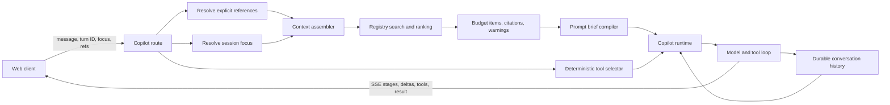

# BuildWealth chat context management: source review and openAuthor recommendations

Date: 2026-08-30

Scope: static inspection of the current local working trees. BuildWealth was treated as read-only. No runtime behavior is inferred where the code does not establish it.

## Executive conclusion

BuildWealth's strongest reusable idea is not its finance retrieval policy. It is the separation of context into distinct stages: resolve trusted references, assemble and rank candidate evidence, compile a bounded prompt brief, select a bounded tool set, run a durable turn, and return an auditable trace. The route coordinates these stages before invoking the model, while the runtime owns history packing, tool rounds, streaming, and turn persistence. [copilot.py:548–880](~/Documents/code/brady/BuildWealth/services/orchestrator/src/buildwealth_orchestrator/routes/copilot.py:548) [copilot_runtime.py:717–929](~/Documents/code/brady/BuildWealth/services/orchestrator/src/buildwealth_orchestrator/services/copilot_runtime.py:717)

openAuthor already has useful foundations: deterministic lexical retrieval with freshness metadata and citations, persisted JSONL messages with `context_used`, reviewed execution for mutating tools, provider token/spend checks, and clickable source chips in the desktop UI. [retrieval.py:243–434](~/Documents/code/brady/openAuthor/openauthor/retrieval.py:243) [chat.py:529–604](~/Documents/code/brady/openAuthor/openauthor/chat.py:529) [ai.py:1514–1682](~/Documents/code/brady/openAuthor/openauthor/ai.py:1514) [ChatPanel.tsx:266–280](~/Documents/code/brady/openAuthor/desktop/src/components/secondary/ChatPanel.tsx:266)

The recommended direction is therefore evolutionary: retain openAuthor's domain model, retrieval index, VCS anchors, and reviewed-write behavior; independently implement equivalent generic contracts and orchestration patterns; and create one typed `ContextPack` and durable `AssistantTurn` protocol shared by text chat and OpenAI Realtime voice. Do not transplant BuildWealth's finance registry, focus taxonomy, keyword intent classifier, prompt slices, or materiality policy.

License note: no `LICENSE`, `COPYING`, or `NOTICE` file was found in the local
BuildWealth checkout during this review. The source is therefore evidence and
architectural inspiration only. None of the candidates below authorizes source
copying; every adopted behavior must be independently implemented unless the
owner later supplies explicit reuse terms.

## Architecture flow



The server resolves reference IDs inside the authorized workspace, calculates effective focus, starts a durable turn, assembles context, builds the prompt brief, and selects tools before the runtime call. [copilot.py:548–880](~/Documents/code/brady/BuildWealth/services/orchestrator/src/buildwealth_orchestrator/routes/copilot.py:548) The runtime then packs history, constructs system messages, executes bounded model/tool rounds, persists the answer and traces, and returns stable conversation/message/turn IDs. [copilot_runtime.py:700–751](~/Documents/code/brady/BuildWealth/services/orchestrator/src/buildwealth_orchestrator/services/copilot_runtime.py:700) [copilot_runtime.py:934–1122](~/Documents/code/brady/BuildWealth/services/orchestrator/src/buildwealth_orchestrator/services/copilot_runtime.py:934)

The streaming endpoint exposes lifecycle, tool, delta, result, and error events and marks disconnected, stopped, and failed turns explicitly. [copilot.py:1000–1101](~/Documents/code/brady/BuildWealth/services/orchestrator/src/buildwealth_orchestrator/routes/copilot.py:1000) The browser creates a durable client turn ID before sending, applies streamed events, and can retry a failed or stopped turn with that same ID. [copilot.js:788–930](~/Documents/code/brady/BuildWealth/services/orchestrator/src/buildwealth_orchestrator/web-v2/views/copilot.js:788) [copilot.js:554–590](~/Documents/code/brady/BuildWealth/services/orchestrator/src/buildwealth_orchestrator/web-v2/views/copilot.js:554)

## How BuildWealth manages context

### 1. Context selection

BuildWealth combines four selectors rather than relying on nearest-neighbor retrieval alone:

1. Explicit references are bounded to eight `{type, id}` objects, validated strictly, deduplicated, resolved server-side, and rejected as a whole if any reference is invalid or outside the workspace. [copilot_context_references.py:22–43](~/Documents/code/brady/BuildWealth/services/orchestrator/src/buildwealth_orchestrator/services/copilot_context_references.py:22) [copilot_context_references.py:144–286](~/Documents/code/brady/BuildWealth/services/orchestrator/src/buildwealth_orchestrator/services/copilot_context_references.py:144) The lookup contract verifies returned type, ID, workspace, required fields, and evidence before prompt use. [copilot_context_references.py:418–510](~/Documents/code/brady/BuildWealth/services/orchestrator/src/buildwealth_orchestrator/services/copilot_context_references.py:418)
2. A deterministic keyword classifier maps the question to finance intents. [context_intelligence.py:2130–2228](~/Documents/code/brady/BuildWealth/services/orchestrator/src/buildwealth_orchestrator/services/context_intelligence.py:2130)
3. Session focus combines persisted focus, a natural-language patch, or an explicit request override; it derives primary, secondary, and muted domains and applies score multipliers of 1.25, 1.10, and 0.55, plus 1.35 for pinned entities. [session_focus.py:369–397](~/Documents/code/brady/BuildWealth/services/orchestrator/src/buildwealth_orchestrator/services/session_focus.py:369) [session_focus.py:516–727](~/Documents/code/brady/BuildWealth/services/orchestrator/src/buildwealth_orchestrator/services/session_focus.py:516)
4. The assembler builds the canonical structured snapshot first, searches the context registry, applies focus boosts, budgets the selected results, and emits citations, conflicts, warnings, and a context trace. Narrow mode lowers its item/text limits from 12/6,000 characters to 8/4,000 characters. [context_intelligence.py:2231–2374](~/Documents/code/brady/BuildWealth/services/orchestrator/src/buildwealth_orchestrator/services/context_intelligence.py:2231)

Muted domains are not an absolute safety filter: high- and critical-severity warnings can still surface. [session_focus.py:747–889](~/Documents/code/brady/BuildWealth/services/orchestrator/src/buildwealth_orchestrator/services/session_focus.py:747)

### 2. Retrieval and ranking

The registry persists normalized `ContextItem` records with domain/entity identity, source reference, authority, text, structured payload, provenance, quality, materiality, and timestamps. [context_intelligence.py:416–433](~/Documents/code/brady/BuildWealth/services/orchestrator/src/buildwealth_orchestrator/services/context_intelligence.py:416) Its SQLite schema also stores rebuild runs, metadata, embeddings, context candidates, and lifecycle events. [context_intelligence.py:436–580](~/Documents/code/brady/BuildWealth/services/orchestrator/src/buildwealth_orchestrator/services/context_intelligence.py:436)

Search loads a bounded registry set, filters by domain/entity constraints, optionally calculates embedding similarity, computes a composite score, rejects lexical misses when there is neither a filter nor semantic evidence, and sorts by score, materiality, and recency. [context_intelligence.py:1201–1328](~/Documents/code/brady/BuildWealth/services/orchestrator/src/buildwealth_orchestrator/services/context_intelligence.py:1201) The assembler performs a focused primary search, can add a plan-specific pass, falls back more broadly, and deduplicates results. [context_intelligence.py:2376–2432](~/Documents/code/brady/BuildWealth/services/orchestrator/src/buildwealth_orchestrator/services/context_intelligence.py:2376) [context_intelligence.py:4034–4043](~/Documents/code/brady/BuildWealth/services/orchestrator/src/buildwealth_orchestrator/services/context_intelligence.py:4034)

With semantic retrieval enabled, the rank weights are lexical 0.32, semantic 0.24, exact match 0.16, quality 0.12, recency 0.07, authority 0.05, and materiality 0.04. Without semantics they become 0.40, 0, 0.18, 0.18, 0.10, 0.08, and 0.06 respectively. [context_intelligence.py:2595–2642](~/Documents/code/brady/BuildWealth/services/orchestrator/src/buildwealth_orchestrator/services/context_intelligence.py:2595) Lexical scoring includes substring, phrase, and entity bonuses and searches both display text and serialized structured/provenance/quality fields. [context_intelligence.py:2645–2686](~/Documents/code/brady/BuildWealth/services/orchestrator/src/buildwealth_orchestrator/services/context_intelligence.py:2645)

Embeddings are optional and disabled by default. On search, an empty registry triggers a rebuild; embedding failure falls back to lexical retrieval. Existing vectors are reused when the indexed text hash is unchanged. [settings.py:135–148](~/Documents/code/brady/BuildWealth/services/orchestrator/src/buildwealth_orchestrator/settings.py:135) [context_intelligence.py:767–851](~/Documents/code/brady/BuildWealth/services/orchestrator/src/buildwealth_orchestrator/services/context_intelligence.py:767) [context_intelligence.py:1803–1848](~/Documents/code/brady/BuildWealth/services/orchestrator/src/buildwealth_orchestrator/services/context_intelligence.py:1803)

### 3. Token and size budgeting

BuildWealth uses layered character and count bounds, not a single authoritative token budget. Retrieval is capped by item count and aggregate text characters; oversized item text is truncated and the resulting budget trace records counts and truncation. [context_intelligence.py:4046–4099](~/Documents/code/brady/BuildWealth/services/orchestrator/src/buildwealth_orchestrator/services/context_intelligence.py:4046) Explicit-reference prompt text is independently capped at 16,000 characters and drops bounded evidence first if needed. [copilot_context_references.py:22–43](~/Documents/code/brady/BuildWealth/services/orchestrator/src/buildwealth_orchestrator/services/copilot_context_references.py:22) [copilot_context_references.py:289–326](~/Documents/code/brady/BuildWealth/services/orchestrator/src/buildwealth_orchestrator/services/copilot_context_references.py:289)

The prompt brief has a 15,000-character hard cap, a 12,000-character focused-structured-data allowance, at most 12 citations, and at most five warnings and five conflicts. [copilot_prompt_brief.py:14–29](~/Documents/code/brady/BuildWealth/services/orchestrator/src/buildwealth_orchestrator/services/copilot_prompt_brief.py:14) Its truncation is staged: lower-priority structured sections and retrieval detail are shed while safety, session focus, and tool guidance are preserved, with an emergency minimal representation as the last fallback. [copilot_prompt_brief.py:377–475](~/Documents/code/brady/BuildWealth/services/orchestrator/src/buildwealth_orchestrator/services/copilot_prompt_brief.py:377)

Conversation history has a separate message-count limit and character limit. At the default 24 messages, the runtime's formula permits up to 96,000 characters; it reverse-packs the newest messages and trims the newest oversized message head-and-tail. [settings.py:119–127](~/Documents/code/brady/BuildWealth/services/orchestrator/src/buildwealth_orchestrator/settings.py:119) [copilot_runtime.py:581–632](~/Documents/code/brady/BuildWealth/services/orchestrator/src/buildwealth_orchestrator/services/copilot_runtime.py:581) [copilot_runtime.py:700–751](~/Documents/code/brady/BuildWealth/services/orchestrator/src/buildwealth_orchestrator/services/copilot_runtime.py:700) The runtime estimates prompt tokens as characters divided by four for tracing, but that estimate does not govern a global prompt limit. [copilot_runtime.py:753–847](~/Documents/code/brady/BuildWealth/services/orchestrator/src/buildwealth_orchestrator/services/copilot_runtime.py:753)

### 4. Conversation history and persistence

Conversations use schema version 2 and persist messages, turns, session focus, model preference, risk lens, and interaction mode. Legacy records are normalized with stable IDs, turn links, and statuses. [copilot_runtime.py:15–69](~/Documents/code/brady/BuildWealth/services/orchestrator/src/buildwealth_orchestrator/services/copilot_runtime.py:15) [copilot_runtime.py:82–182](~/Documents/code/brady/BuildWealth/services/orchestrator/src/buildwealth_orchestrator/services/copilot_runtime.py:82)

Starting a turn persists the user message immediately. Reusing an existing turn ID avoids duplicating that user message, which makes retry behavior idempotent at the conversation layer. [copilot_runtime.py:216–283](~/Documents/code/brady/BuildWealth/services/orchestrator/src/buildwealth_orchestrator/services/copilot_runtime.py:216) Turns move through explicit statuses, and completed assistant messages retain context and tool traces. [copilot_runtime.py:285–388](~/Documents/code/brady/BuildWealth/services/orchestrator/src/buildwealth_orchestrator/services/copilot_runtime.py:285) [copilot_runtime.py:1089–1122](~/Documents/code/brady/BuildWealth/services/orchestrator/src/buildwealth_orchestrator/services/copilot_runtime.py:1089)

Storage is a per-conversation JSON file written with `Path.write_text`; this implementation is not an atomic replace and has no visible compare-and-swap guard. [copilot_runtime.py:184–214](~/Documents/code/brady/BuildWealth/services/orchestrator/src/buildwealth_orchestrator/services/copilot_runtime.py:184)

### 5. Prompt assembly

The prompt compiler explicitly avoids dumping the complete assembled context into the model prompt; full canonical state remains available through tools. [copilot_prompt_brief.py:1–6](~/Documents/code/brady/BuildWealth/services/orchestrator/src/buildwealth_orchestrator/services/copilot_prompt_brief.py:1) It builds compact JSON containing focus, intent, a summary, quality/scope information, a selected structured slice, retrieval results, citations, conflicts, warnings, budget metadata, and tool guidance. [copilot_prompt_brief.py:538–619](~/Documents/code/brady/BuildWealth/services/orchestrator/src/buildwealth_orchestrator/services/copilot_prompt_brief.py:538)

The runtime creates two system messages: policy/mode guidance and a wrapper that labels financial context as untrusted. It then appends packed history and the current user message. [copilot_runtime.py:700–751](~/Documents/code/brady/BuildWealth/services/orchestrator/src/buildwealth_orchestrator/services/copilot_runtime.py:700) Resolved explicit references are also rendered as untrusted evidence, with bounded fields and provenance retained. [copilot_context_references.py:289–326](~/Documents/code/brady/BuildWealth/services/orchestrator/src/buildwealth_orchestrator/services/copilot_context_references.py:289)

### 6. Citations and provenance

Each selected retrieval result preserves source reference, authority, provenance, quality, score, and score breakdown. [context_intelligence.py:2769–2790](~/Documents/code/brady/BuildWealth/services/orchestrator/src/buildwealth_orchestrator/services/context_intelligence.py:2769) The assembler derives a compact citation record for each included item, while the reference trace intentionally excludes evidence values. [context_intelligence.py:4102–4111](~/Documents/code/brady/BuildWealth/services/orchestrator/src/buildwealth_orchestrator/services/context_intelligence.py:4102) [copilot_context_references.py:96–141](~/Documents/code/brady/BuildWealth/services/orchestrator/src/buildwealth_orchestrator/services/copilot_context_references.py:96)

The response persists a context trace and the UI exposes source/calculation summaries and deep links. [copilot.py:808–880](~/Documents/code/brady/BuildWealth/services/orchestrator/src/buildwealth_orchestrator/routes/copilot.py:808) [thread.js:295–430](~/Documents/code/brady/BuildWealth/services/orchestrator/src/buildwealth_orchestrator/web-v2/views/copilot/thread.js:295) This is turn-level provenance: the response schema and UI do not encode claim spans mapped to source IDs. [schemas.py:2194–2209](~/Documents/code/brady/BuildWealth/services/orchestrator/src/buildwealth_orchestrator/schemas.py:2194) [thread.js:295–430](~/Documents/code/brady/BuildWealth/services/orchestrator/src/buildwealth_orchestrator/web-v2/views/copilot/thread.js:295)

### 7. Caching

The generic cache is an in-memory TTL cache with maximum-entry eviction and hit/miss/write metrics. It evicts the oldest timestamp when full. [context_cache.py:1–111](~/Documents/code/brady/BuildWealth/services/orchestrator/src/buildwealth_orchestrator/services/context_cache.py:1) Defaults are 128 entries, 180 seconds for research, and 120 seconds for projection data. [settings.py:119–148](~/Documents/code/brady/BuildWealth/services/orchestrator/src/buildwealth_orchestrator/settings.py:119)

Projection cache identity includes workspace, plan update identity, portfolio as-of/value, and currency; research identity includes workspace, provider, interval, period, and symbols. Both report cache behavior into the context trace. [main.py:12473–12582](~/Documents/code/brady/BuildWealth/services/orchestrator/src/buildwealth_orchestrator/main.py:12473) [main.py:12586–12724](~/Documents/code/brady/BuildWealth/services/orchestrator/src/buildwealth_orchestrator/main.py:12586)

### 8. Tool execution

Tools carry metadata for kind, domain, provider support, and mode. The selector is deterministic, observes active/muted domains and provider caps, excludes write/apply operations, and permits draft tools only in review mode. [copilot_policy.py:152–362](~/Documents/code/brady/BuildWealth/services/orchestrator/src/buildwealth_orchestrator/services/copilot_policy.py:152) Startup validates the entire tool catalog against this policy and fails on classification mismatch. [main.py:17537–17665](~/Documents/code/brady/BuildWealth/services/orchestrator/src/buildwealth_orchestrator/main.py:17537)

The runtime limits model/tool rounds, sanitizes tool errors, and clips the tool result shown back to the model to 12,000 characters. [copilot_runtime.py:581–698](~/Documents/code/brady/BuildWealth/services/orchestrator/src/buildwealth_orchestrator/services/copilot_runtime.py:581) The full tool result still appears in persisted `tool_traces`, while the clipped form is what re-enters the model conversation. [copilot_runtime.py:934–1076](~/Documents/code/brady/BuildWealth/services/orchestrator/src/buildwealth_orchestrator/services/copilot_runtime.py:934)

### 9. Client/server contract

The request contract includes conversation/turn IDs, message, symbols, mode, model/risk settings, context options, session focus, and exact context references. The response includes durable IDs/status, answer, tool traces, context trace, risk trace, citations-related metadata, and pending actions. [schemas.py:1878–1911](~/Documents/code/brady/BuildWealth/services/orchestrator/src/buildwealth_orchestrator/schemas.py:1878) [schemas.py:2062–2209](~/Documents/code/brady/BuildWealth/services/orchestrator/src/buildwealth_orchestrator/schemas.py:2062)

The browser sends auth and workspace headers and implements both blocking and SSE chat APIs. [api.js:40–53](~/Documents/code/brady/BuildWealth/services/orchestrator/src/buildwealth_orchestrator/web-v2/lib/api.js:40) [api.js:112–157](~/Documents/code/brady/BuildWealth/services/orchestrator/src/buildwealth_orchestrator/web-v2/lib/api.js:112) [api.js:520–553](~/Documents/code/brady/BuildWealth/services/orchestrator/src/buildwealth_orchestrator/web-v2/lib/api.js:520) Streaming has semantic events for stage, turn, tool, pending action, answer delta, result, and error—not just text deltas. [copilot.js:854–930](~/Documents/code/brady/BuildWealth/services/orchestrator/src/buildwealth_orchestrator/web-v2/views/copilot.js:854)

## Key interfaces and data structures

| Structure | Role | Adoption assessment |
|---|---|---|
| `ContextItem` | Normalized searchable evidence with identity, authority, payload, provenance, quality, and materiality. [context_intelligence.py:416–433](~/Documents/code/brady/BuildWealth/services/orchestrator/src/buildwealth_orchestrator/services/context_intelligence.py:416) | Interface shape is useful; finance fields and registry population are not directly portable. |
| `ContextReference` / resolved reference | Tiny client `{type,id}` contract; server adapter returns a workspace-bound canonical envelope. [copilot_context_references.py:52–141](~/Documents/code/brady/BuildWealth/services/orchestrator/src/buildwealth_orchestrator/services/copilot_context_references.py:52) | Independently implement equivalent resolver and validation mechanics with author-domain type adapters. |
| `EffectiveFocus` | Merged user/session/intent focus plus registry-domain routing. [session_focus.py:516–636](~/Documents/code/brady/BuildWealth/services/orchestrator/src/buildwealth_orchestrator/services/session_focus.py:516) | Pattern only; openAuthor needs manuscript scope and authoring entities, not finance domains. |
| Prompt brief | Bounded model-facing projection of a larger canonical state. [copilot_prompt_brief.py:538–619](~/Documents/code/brady/BuildWealth/services/orchestrator/src/buildwealth_orchestrator/services/copilot_prompt_brief.py:538) | Compiler architecture is reusable; its field selection is finance-specific. |
| `ProviderCapabilities`, `ToolMetadata`, selection context/result | Deterministic tool exposure independent of model prompting. [copilot_policy.py:152–263](~/Documents/code/brady/BuildWealth/services/orchestrator/src/buildwealth_orchestrator/services/copilot_policy.py:152) | Strong independent-reimplementation candidate after replacing domain enums. |
| Conversation/turn/message records | Durable IDs, status, retry, trace, and pending-action state. [copilot_runtime.py:15–182](~/Documents/code/brady/BuildWealth/services/orchestrator/src/buildwealth_orchestrator/services/copilot_runtime.py:15) | Adopt the schema and lifecycle; do not copy the non-atomic file store. |
| SSE events | Semantic progress and final-state protocol. [copilot.py:1048–1101](~/Documents/code/brady/BuildWealth/services/orchestrator/src/buildwealth_orchestrator/routes/copilot.py:1048) | Define an openAuthor-native event vocabulary across text, sidecar IPC, and Realtime. |

## Strengths

- Trust boundaries are explicit. Client references are opaque IDs resolved under workspace authorization, evidence is bounded and marked untrusted, and tool results are not silently treated as mutation authority. [copilot_context_references.py:1–10](~/Documents/code/brady/BuildWealth/services/orchestrator/src/buildwealth_orchestrator/services/copilot_context_references.py:1) [copilot_policy.py:43–127](~/Documents/code/brady/BuildWealth/services/orchestrator/src/buildwealth_orchestrator/services/copilot_policy.py:43)
- Selection is explainable. Retrieval returns score components, selected items retain provenance, and focus and budget decisions are carried into a trace. [context_intelligence.py:2769–2790](~/Documents/code/brady/BuildWealth/services/orchestrator/src/buildwealth_orchestrator/services/context_intelligence.py:2769) [session_focus.py:892–928](~/Documents/code/brady/BuildWealth/services/orchestrator/src/buildwealth_orchestrator/services/session_focus.py:892)
- Prompt composition is intentionally distinct from canonical state assembly, allowing the model projection to be compact without reducing tool access to full state. [copilot_prompt_brief.py:1–6](~/Documents/code/brady/BuildWealth/services/orchestrator/src/buildwealth_orchestrator/services/copilot_prompt_brief.py:1) [copilot_prompt_brief.py:538–619](~/Documents/code/brady/BuildWealth/services/orchestrator/src/buildwealth_orchestrator/services/copilot_prompt_brief.py:538)
- Turn identity and status survive streaming failures and retries. [copilot_runtime.py:216–328](~/Documents/code/brady/BuildWealth/services/orchestrator/src/buildwealth_orchestrator/services/copilot_runtime.py:216) [copilot.py:1000–1101](~/Documents/code/brady/BuildWealth/services/orchestrator/src/buildwealth_orchestrator/routes/copilot.py:1000)
- Tool exposure is policy-driven and validated at startup instead of delegated to model discretion. [copilot_policy.py:279–362](~/Documents/code/brady/BuildWealth/services/orchestrator/src/buildwealth_orchestrator/services/copilot_policy.py:279) [main.py:17537–17665](~/Documents/code/brady/BuildWealth/services/orchestrator/src/buildwealth_orchestrator/main.py:17537)
- Safety-relevant context can override user focus muting, a useful precedent for continuity contradictions and destructive authoring operations. [session_focus.py:747–889](~/Documents/code/brady/BuildWealth/services/orchestrator/src/buildwealth_orchestrator/services/session_focus.py:747)

## Weaknesses and risks

- There is no end-to-end input-token budget. Independent maxima can accumulate: a 15,000-character brief, a 16,000-character reference block, up to roughly 96,000 history characters at defaults, policy/tool schemas, and tool results. Token estimation is diagnostic rather than an admission controller. [copilot_prompt_brief.py:14–29](~/Documents/code/brady/BuildWealth/services/orchestrator/src/buildwealth_orchestrator/services/copilot_prompt_brief.py:14) [copilot_context_references.py:22–43](~/Documents/code/brady/BuildWealth/services/orchestrator/src/buildwealth_orchestrator/services/copilot_context_references.py:22) [copilot_runtime.py:581–632](~/Documents/code/brady/BuildWealth/services/orchestrator/src/buildwealth_orchestrator/services/copilot_runtime.py:581) [copilot_runtime.py:753–847](~/Documents/code/brady/BuildWealth/services/orchestrator/src/buildwealth_orchestrator/services/copilot_runtime.py:753)
- History is truncation-only. It keeps recent messages within count/character bounds but has no durable conversation summary or fact promotion step, so important early decisions can disappear. [copilot_runtime.py:700–751](~/Documents/code/brady/BuildWealth/services/orchestrator/src/buildwealth_orchestrator/services/copilot_runtime.py:700)
- Registry rebuild is coarse: `replace_all` deletes all context items before reinserting, and ordinary search only rebuilds automatically when the registry is empty. This can leave a non-empty registry stale unless another workflow rebuilds it. [context_intelligence.py:588–627](~/Documents/code/brady/BuildWealth/services/orchestrator/src/buildwealth_orchestrator/services/context_intelligence.py:588) [context_intelligence.py:1803–1848](~/Documents/code/brady/BuildWealth/services/orchestrator/src/buildwealth_orchestrator/services/context_intelligence.py:1803)
- Search scans up to 5,000 loaded items and scores them in application code. That is acceptable at small personal-workspace scale but is not a scalable retrieval backend. [context_intelligence.py:738–765](~/Documents/code/brady/BuildWealth/services/orchestrator/src/buildwealth_orchestrator/services/context_intelligence.py:738) [context_intelligence.py:1201–1306](~/Documents/code/brady/BuildWealth/services/orchestrator/src/buildwealth_orchestrator/services/context_intelligence.py:1201)
- Conversation writes replace the JSON file directly, so a process interruption can expose partial-write risk and concurrent writers have no record-version check. [copilot_runtime.py:184–214](~/Documents/code/brady/BuildWealth/services/orchestrator/src/buildwealth_orchestrator/services/copilot_runtime.py:184)
- Full tool results are retained in persisted traces even though only a clipped form is sent to the model. This increases storage and privacy exposure and can diverge from what the model actually saw. [copilot_runtime.py:934–1076](~/Documents/code/brady/BuildWealth/services/orchestrator/src/buildwealth_orchestrator/services/copilot_runtime.py:934)
- Provenance is answer-level, not claim-level. Users can inspect sources, but the contract cannot say which sentence depends on which source. [schemas.py:2194–2209](~/Documents/code/brady/BuildWealth/services/orchestrator/src/buildwealth_orchestrator/schemas.py:2194) [thread.js:295–430](~/Documents/code/brady/BuildWealth/services/orchestrator/src/buildwealth_orchestrator/web-v2/views/copilot/thread.js:295)
- Candidate authority mapping is counterintuitive: non-`authoritative` influence maps to `source_evidence`, while `authoritative` maps to `derived`. This deserves verification before reuse. [context_intelligence.py:3332–3382](~/Documents/code/brady/BuildWealth/services/orchestrator/src/buildwealth_orchestrator/services/context_intelligence.py:3332)

## Current openAuthor comparison

openAuthor's context profile already captures current scene, selected text, scene radius, codex behavior, retrieval behavior/limit, history token budget, and read/write tool policy. [chat.py:217–343](~/Documents/code/brady/openAuthor/openauthor/chat.py:217) `_resolve_context` combines current and explicit scenes, first/last project anchors, neighboring scenes, substring-matched codex entries, retrieval results, continuity issues, and a partial scene index; it places complete scene bodies and other context into one JSON-like prompt object. [chat.py:623–799](~/Documents/code/brady/openAuthor/openauthor/chat.py:623)

Its retrieval is a compact deterministic index over scene and codex chunks. It uses 90-word chunks with 20-word overlap, token-frequency/coverage scoring, deterministic ordering, source citations, and git/source-digest freshness checks. [retrieval.py:36–157](~/Documents/code/brady/openAuthor/openauthor/retrieval.py:36) [retrieval.py:188–289](~/Documents/code/brady/openAuthor/openauthor/retrieval.py:188) [retrieval.py:292–434](~/Documents/code/brady/openAuthor/openauthor/retrieval.py:292)

Messages are appended to JSONL with `context_used`, tool calls, and usage. History uses a rough token estimate, takes a contiguous newest suffix, turns prior tool output into clipped user text, merges equal roles, and drops a leading assistant message. There is no durable turn record or status in the persisted message shape. [chat.py:454–604](~/Documents/code/brady/openAuthor/openauthor/chat.py:454) [types.ts:449–493](~/Documents/code/brady/openAuthor/desktop/src/types.ts:449)

Prompt assembly currently sends a short system instruction plus the resolved context serialized directly into the user prompt. In agent mode it exposes the complete static tool list, including read, write, and risky tools, although non-read operations are returned as pending rather than executed immediately. [chat.py:37–204](~/Documents/code/brady/openAuthor/openauthor/chat.py:37) [chat.py:802–910](~/Documents/code/brady/openAuthor/openauthor/chat.py:802) [chat.py:913–1109](~/Documents/code/brady/openAuthor/openauthor/chat.py:913)

Provider execution does enforce projected token/spend policy, and generation logs record the full system prompt, user prompt, response, and usage. That protects budget but also means manuscript/context text is duplicated into logs. [ai.py:1462–1682](~/Documents/code/brady/openAuthor/openauthor/ai.py:1462)

The desktop sidecar protocol has request IDs and streamed `chat.delta`, but the chat payload and message contracts lack durable turn IDs/status and typed context traces. [server.py:33–77](~/Documents/code/brady/openAuthor/openauthor/server.py:33) [server.py:109–231](~/Documents/code/brady/openAuthor/openauthor/server.py:109) [api.ts:856–904](~/Documents/code/brady/openAuthor/desktop/src/api.ts:856) The server also serializes sends behind one `_send_lock`, which would prevent concurrent assistant sends within that sidecar process. [server.py:63–77](~/Documents/code/brady/openAuthor/openauthor/server.py:63) [server.py:186–231](~/Documents/code/brady/openAuthor/openauthor/server.py:186)

The UI does preserve a useful provenance affordance: it extracts unique retrieval citations from `context_used` and renders clickable scene/codex chips. [ChatPanel.tsx:70–91](~/Documents/code/brady/openAuthor/desktop/src/components/secondary/ChatPanel.tsx:70) [ChatPanel.tsx:266–280](~/Documents/code/brady/openAuthor/desktop/src/components/secondary/ChatPanel.tsx:266) [ChatPanel.tsx:740–754](~/Documents/code/brady/openAuthor/desktop/src/components/secondary/ChatPanel.tsx:740)

## Independent reimplementation candidates

These are behaviors worth recreating behind openAuthor-native interfaces. They
are not source-copying candidates under the currently available license
evidence.

| Candidate | Behavior to implement | Required adaptation |
|---|---|---|
| `ExpiringCache` | The complete small TTL/max-entry/metrics implementation. [context_cache.py:1–111](~/Documents/code/brady/BuildWealth/services/orchestrator/src/buildwealth_orchestrator/services/context_cache.py:1) | Add locking if voice/text can access it concurrently; use content/version-aware keys. |
| Exact-reference resolver core | Strict `{type,id}` validation, deduplication, all-or-nothing resolution, workspace/project verification, evidence bounding, sanitized errors, and value-free trace. [copilot_context_references.py:52–141](~/Documents/code/brady/BuildWealth/services/orchestrator/src/buildwealth_orchestrator/services/copilot_context_references.py:52) [copilot_context_references.py:144–340](~/Documents/code/brady/BuildWealth/services/orchestrator/src/buildwealth_orchestrator/services/copilot_context_references.py:144) | Rename workspace to project; inject supported types and authoring lookup adapters. |
| Tool policy core | `ProviderCapabilities`, `ToolMetadata`, selection context/result, deterministic filtering, provider caps, and startup catalog validation. [copilot_policy.py:152–362](~/Documents/code/brady/BuildWealth/services/orchestrator/src/buildwealth_orchestrator/services/copilot_policy.py:152) [main.py:17537–17665](~/Documents/code/brady/BuildWealth/services/orchestrator/src/buildwealth_orchestrator/main.py:17537) | Replace finance domains/modes with authoring scopes and openAuthor's read/propose/apply classes. |
| Retrieval budget helper | Item-count/text-character packing, per-item truncation, citation construction, and explicit budget trace. [context_intelligence.py:4046–4111](~/Documents/code/brady/BuildWealth/services/orchestrator/src/buildwealth_orchestrator/services/context_intelligence.py:4046) | Generalize field names and upgrade the outer budget to actual model tokens. |
| Durable turn state machine | Stable client turn ID, idempotent start/retry, persisted status transitions, and association of user/assistant messages and traces. [copilot_runtime.py:216–388](~/Documents/code/brady/BuildWealth/services/orchestrator/src/buildwealth_orchestrator/services/copilot_runtime.py:216) | Reimplement on openAuthor's atomic JSONL/storage layer; do not copy `ConversationStore.save`. |
| Semantic event vocabulary | Stage/turn/tool/pending/delta/result/error events and final durable IDs/status. [copilot.py:1048–1101](~/Documents/code/brady/BuildWealth/services/orchestrator/src/buildwealth_orchestrator/routes/copilot.py:1048) | Define one transport-neutral event union for sidecar IPC, web/SSE, and Realtime voice. |

## Inspiration-only candidates

- The finance `ContextItem` registry and indexers should inspire a normalized authoring evidence model, but the specific domains, entity types, authority values, materiality values, and profile/plan/recommendation/watchlist indexers are finance policy. [context_intelligence.py:39–115](~/Documents/code/brady/BuildWealth/services/orchestrator/src/buildwealth_orchestrator/services/context_intelligence.py:39) [context_intelligence.py:1714–1728](~/Documents/code/brady/BuildWealth/services/orchestrator/src/buildwealth_orchestrator/services/context_intelligence.py:1714)
- Session focus merging and safety overrides are valuable patterns; the finance hierarchy and multipliers should become authoring concepts such as current selection, scene/chapter arc, character, setting, continuity, voice/style, and project-wide canon. [session_focus.py:17–126](~/Documents/code/brady/BuildWealth/services/orchestrator/src/buildwealth_orchestrator/services/session_focus.py:17) [session_focus.py:540–727](~/Documents/code/brady/BuildWealth/services/orchestrator/src/buildwealth_orchestrator/services/session_focus.py:540)
- The weighted hybrid ranker is a useful template, but authoring rank should include narrative proximity, explicit mention, canon status, scene/chapter scope, continuity relevance, and source version rather than financial quality/materiality. [context_intelligence.py:2595–2713](~/Documents/code/brady/BuildWealth/services/orchestrator/src/buildwealth_orchestrator/services/context_intelligence.py:2595)
- The prompt brief's staged degradation is the right pattern, but its structured slices are finance-specific and should not be copied. [copilot_prompt_brief.py:233–475](~/Documents/code/brady/BuildWealth/services/orchestrator/src/buildwealth_orchestrator/services/copilot_prompt_brief.py:233)
- Context candidates and lifecycle events suggest a “story memory proposal” workflow: conversation-derived facts remain non-canonical until an author accepts them. The BuildWealth candidate fields, influence rules, and finance summarizer should not be reused verbatim. [context_intelligence.py:1856–1951](~/Documents/code/brady/BuildWealth/services/orchestrator/src/buildwealth_orchestrator/services/context_intelligence.py:1856) [context_intelligence.py:3324–3382](~/Documents/code/brady/BuildWealth/services/orchestrator/src/buildwealth_orchestrator/services/context_intelligence.py:3324)
- BuildWealth's whole-file conversation store is a lifecycle reference, not a storage implementation to copy. openAuthor already has append-oriented JSONL and an atomic rewrite path for truncation/regeneration. [copilot_runtime.py:184–214](~/Documents/code/brady/BuildWealth/services/orchestrator/src/buildwealth_orchestrator/services/copilot_runtime.py:184) [chat.py:454–526](~/Documents/code/brady/openAuthor/openauthor/chat.py:454)

## Concrete recommendations for openAuthor voice + text context

### A. One context engine for both modalities

Introduce transport-neutral contracts:

```text
AssistantContextRequest
  project_id, turn_id, modality, message/transcript
  scope, current_scene_id, selected_text
  explicit_references[], context_profile, session_state_version

ContextPack
  prompt_brief
  resolved_references[]
  retrieved_items[]
  citations[]
  warnings[] / conflicts[]
  budget
  trace

AssistantTurn
  turn_id, thread_id, status, modality
  user_message_id, assistant_message_id
  context_trace, tool_trace, usage, error
```

Both text chat and Realtime voice should call the same `build_context_pack(request)` function. Text can pass a completed user message; voice can call it at session start and refresh it when a final transcript, explicit reference, current scene, selection, or project version changes. This preserves BuildWealth's useful separation between canonical context, model-facing prompt brief, and runtime. [copilot.py:747–880](~/Documents/code/brady/BuildWealth/services/orchestrator/src/buildwealth_orchestrator/routes/copilot.py:747) [copilot_prompt_brief.py:1–6](~/Documents/code/brady/BuildWealth/services/orchestrator/src/buildwealth_orchestrator/services/copilot_prompt_brief.py:1)

### B. Define an authoring authority ladder

Use source authority in this order:

1. Current manuscript text and accepted codex/canon records.
2. Explicit selection and author-selected references.
3. Accepted story-memory facts and project/arc summaries.
4. Retrieved scene/codex chunks and derived summaries.
5. Conversation claims not yet accepted into canon.

This adapts BuildWealth's explicit authority and candidate-lifecycle boundaries to writing. [copilot_policy.py:43–127](~/Documents/code/brady/BuildWealth/services/orchestrator/src/buildwealth_orchestrator/services/copilot_policy.py:43) [context_intelligence.py:39–89](~/Documents/code/brady/BuildWealth/services/orchestrator/src/buildwealth_orchestrator/services/context_intelligence.py:39) Conflicts should favor higher authority but remain visible in `ContextTrace`; voice should summarize the conflict briefly while the client displays source links.

### C. Make exact references first-class

Support bounded opaque references for `scene`, `chapter`, `codex_entry`, `character`, `setting`, `storyline`, `story_memory`, and `selection_snapshot`. Resolve IDs locally under the open project, reject stale/mismatched references before starting a turn, and place their source/version metadata in the trace. This replaces today's loosely typed `mentions`/context dictionaries with the strict server-resolved pattern used by BuildWealth. [copilot_context_references.py:144–286](~/Documents/code/brady/BuildWealth/services/orchestrator/src/buildwealth_orchestrator/services/copilot_context_references.py:144) [api.ts:856–904](~/Documents/code/brady/openAuthor/desktop/src/api.ts:856)

### D. Enforce one global prompt budget

Budget the whole model input—policy, dynamic tool schemas, explicit references, prompt brief, retrieval, history, and current message—against the selected model/session limit while reserving response and Realtime overhead. Use the provider tokenizer where available and a conservative fallback otherwise. BuildWealth's independent caps can add up without global enforcement, while openAuthor's provider layer already has the right admission point for token/spend policy. [copilot_runtime.py:581–632](~/Documents/code/brady/BuildWealth/services/orchestrator/src/buildwealth_orchestrator/services/copilot_runtime.py:581) [ai.py:1514–1682](~/Documents/code/brady/openAuthor/openauthor/ai.py:1514)

Use a priority allocator rather than fixed concatenation:

1. Reserve system policy, current user turn, output, and required tool schemas.
2. Preserve explicit selection/references and current-scene evidence.
3. Preserve accepted canon/story memory and safety/continuity conflicts.
4. Pack ranked retrieval.
5. Pack recent raw history, then a durable older-history summary.

Every dropped or truncated section should be recorded in `ContextPack.budget`, following BuildWealth's budget trace and staged brief degradation. [context_intelligence.py:4046–4099](~/Documents/code/brady/BuildWealth/services/orchestrator/src/buildwealth_orchestrator/services/context_intelligence.py:4046) [copilot_prompt_brief.py:406–475](~/Documents/code/brady/BuildWealth/services/orchestrator/src/buildwealth_orchestrator/services/copilot_prompt_brief.py:406)

### E. Extend, do not replace, openAuthor retrieval

Keep openAuthor's source digests, git-aware freshness, chunk citations, and deterministic fallback. [retrieval.py:188–434](~/Documents/code/brady/openAuthor/openauthor/retrieval.py:188) Add metadata filters and a hybrid scorer with:

- exact reference/mention match;
- lexical relevance;
- optional semantic similarity;
- narrative proximity to current scene/chapter;
- canon/acceptance authority;
- continuity relevance;
- source freshness/version match.

Automatically rebuild or incrementally update stale affected sources before querying; do not copy BuildWealth's delete-and-reinsert whole registry or application-side 5,000-item scan. [context_intelligence.py:588–627](~/Documents/code/brady/BuildWealth/services/orchestrator/src/buildwealth_orchestrator/services/context_intelligence.py:588) [context_intelligence.py:1201–1306](~/Documents/code/brady/BuildWealth/services/orchestrator/src/buildwealth_orchestrator/services/context_intelligence.py:1201)

### F. Treat voice as a session with durable turns

Maintain a lightweight Realtime session state containing project/version, current scene/selection, accepted context-pack digest, enabled tool set, and the most recent durable transcript/turn IDs. Refresh context on semantic events, not every audio frame. Commit only final user transcripts and final assistant responses to conversation history; partial transcripts remain ephemeral.

Use one event union across desktop IPC, future web/SSE, and Realtime:

```text
turn.started
transcript.delta | transcript.final
context.ready
tool.started | tool.completed | tool.failed
response.delta | response.final
turn.stopped | turn.failed
```

This extends BuildWealth's durable turn and semantic stream contract beyond text. [copilot_runtime.py:216–328](~/Documents/code/brady/BuildWealth/services/orchestrator/src/buildwealth_orchestrator/services/copilot_runtime.py:216) [copilot.py:1048–1101](~/Documents/code/brady/BuildWealth/services/orchestrator/src/buildwealth_orchestrator/routes/copilot.py:1048) It also addresses openAuthor's current delta-only client callback and message-only persistence. [api.ts:1071–1090](~/Documents/code/brady/openAuthor/desktop/src/api.ts:1071) [chat.py:529–604](~/Documents/code/brady/openAuthor/openauthor/chat.py:529)

### G. Expose fewer tools per turn

Replace openAuthor's all-tools-in-agent-mode behavior with deterministic selection based on modality, scope, user intent, provider capabilities, and authoring mode. [chat.py:913–1109](~/Documents/code/brady/openAuthor/openauthor/chat.py:913) Voice should default to read/search/navigation and proposal tools. Mutating operations should remain reviewable pending actions and should never be directly exposed as model-authorized apply operations, matching the strongest BuildWealth policy boundary. [copilot_policy.py:22–40](~/Documents/code/brady/BuildWealth/services/orchestrator/src/buildwealth_orchestrator/services/copilot_policy.py:22) [copilot_policy.py:279–362](~/Documents/code/brady/BuildWealth/services/orchestrator/src/buildwealth_orchestrator/services/copilot_policy.py:279)

### H. Make provenance useful in speech and on screen

Persist structured citation IDs per turn and preserve the existing clickable chips. [ChatPanel.tsx:266–280](~/Documents/code/brady/openAuthor/desktop/src/components/secondary/ChatPanel.tsx:266) Add optional claim-to-citation IDs in final text segments. In voice, speak only a short attribution when it changes the answer (“In the current scene…”); send full source labels and deep links to the companion UI. Store what the model actually saw—bounded snippets or hashes plus source/version references—not unrestricted full tool payloads.

### I. Apply privacy-aware persistence and caching

Do not store raw audio by default. Persist final transcripts, durable turn state, source references/versions, budget/selection traces, usage, and sanitized errors. Make full prompt logging opt-in or development-only because openAuthor currently records full prompts and manuscript context. [ai.py:1462–1511](~/Documents/code/brady/openAuthor/openauthor/ai.py:1462)

Cache only expensive derived context—summaries, embeddings, and immutable reference snapshots—using keys such as `(project_id, git_head/source_digest, context_profile_version, scope, reference_ids)`. Do not TTL-cache live selected text or unsaved manuscript state. BuildWealth's cache implementation is suitable as a base, but its key design demonstrates why source/version identity matters. [context_cache.py:1–111](~/Documents/code/brady/BuildWealth/services/orchestrator/src/buildwealth_orchestrator/services/context_cache.py:1) [main.py:12473–12724](~/Documents/code/brady/BuildWealth/services/orchestrator/src/buildwealth_orchestrator/main.py:12473)

## Recommended implementation sequence

1. **Contracts and durable turns:** add typed context reference, context pack/trace, citation, turn, and event schemas in Python and TypeScript; add client-generated turn IDs and atomic/idempotent persistence.
2. **Shared context compiler:** split `ChatService._resolve_context` into source assembly, ranking, global budgeting, and prompt rendering; keep the current retrieval engine as the lexical backend.
3. **Tool policy:** classify every existing openAuthor tool and select only relevant read/propose tools per turn; retain review before mutation.
4. **Retrieval and memory:** add metadata/hybrid ranking, incremental freshness, conversation summary, and author-accepted story-memory proposals.
5. **Realtime transport:** connect OpenAI Realtime to the same context compiler, turn store, event union, selected tool registry, and citation contract; keep partial audio/transcripts ephemeral.
6. **Mobile client:** implement microphone/audio session lifecycle, interruption, final transcript and source display, current-scene/selection sync, pending-action review, and reconnect by durable turn/session IDs. Mobile should not own retrieval or canonical context decisions.

The sequencing deliberately puts shared contracts and context policy before audio transport. openAuthor's current chat path already centralizes context resolution, history, tool execution, and persistence inside `ChatService`, so extracting those seams first avoids implementing different context behavior for desktop text and mobile voice. [chat.py:623–1109](~/Documents/code/brady/openAuthor/openauthor/chat.py:623)

## Bottom line

Reuse BuildWealth's small generic cache, strict exact-reference machinery, deterministic tool-policy core, retrieval budgeting helpers, durable turn semantics, and event vocabulary. Reimplement them behind openAuthor-native schemas and atomic persistence. Use BuildWealth's registry, focus, ranking, prompt brief, and context-candidate systems only as architectural references: their finance ontology and policy are too deeply embedded to be safe general-purpose abstractions. The resulting openAuthor design should have one context engine and one turn protocol serving desktop text, desktop voice, and mobile voice/text, with modality-specific transport but identical authority, provenance, budgeting, and tool boundaries.
