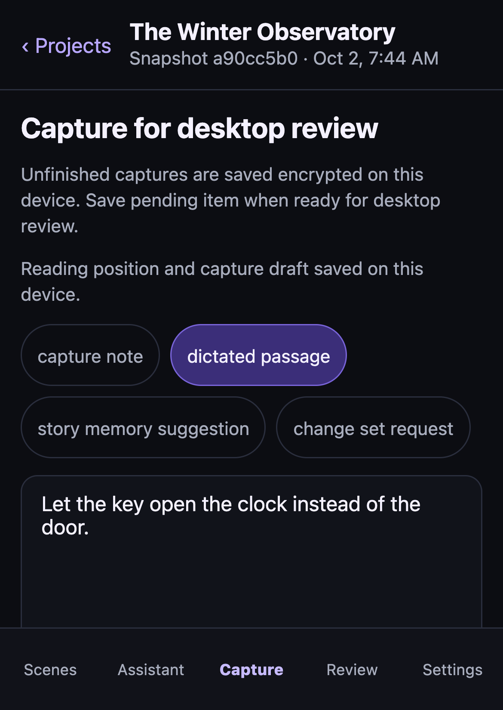
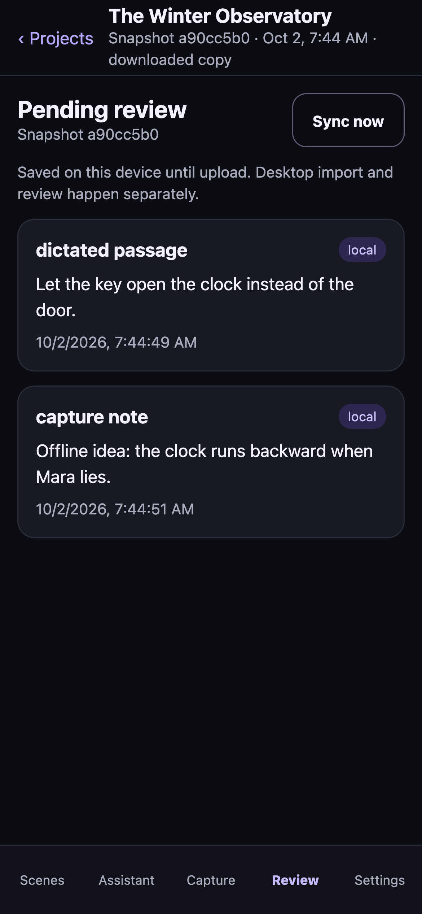

# Mobile reading and capture recovery — 2026-10-02

Status: implemented and locally verified. Production hosting, signed native
execution and physical-phone acceptance remain open.

## Result

A hosted book now restores its reading scene, exact scroll position, passive tab
and unfinished capture after a fresh app instance opens that book. The capture
retains its type, original publication revision and operation identity. Neither
manuscript nor draft plaintext is written to local persistent storage.

Recovery is bound to deployment, account, device, key identity and book. It uses
the existing encrypted cache and remains separate from downloaded publications.
Normal sign-out retains ciphertext but locks access and removes the visible
book/draft. A lock in a second browser window redacts the first immediately;
foreground entry also rechecks local authorization. Device removal deletes
recovery records. Preview/sample drafts remain explicitly temporary.

A visible save status distinguishes pending changes from a completed durable
write. Quota/encryption failure keeps the current draft and offers retry.
Unreadable recovery remains intact and does not get silently overwritten.
Leaving a hosted book waits for recovery. Saving to the review outbox first
persists the capture's operation identity: a restart after outbox commit and
before draft clearing can retry without creating a duplicate.

New publications retain scene focus but reset the old pixel position, preventing
a jump into unrelated text. Unfinished captures keep their original revision for
desktop's stale-review checks.

Native auth sessions now use encrypted local storage rather than new plaintext
SQLite KV records. Legacy sessions are encrypted and decrypt/readback-verified
before their plaintext copy is removed. Failure preserves recoverable data and
reports failure; corrupt encrypted sessions never fall back to plaintext.
Large sessions avoid SecureStore's value-size limit; only wrapping keys go there.
Closed auth leases prevent in-flight SDK refresh responses from recreating saved
credentials after offline sign-out. Browser ciphertext writes compare a
content-free generation in the same IndexedDB transaction, including across
tabs. Native adapters share a synchronous generation and serialized write queue.
Cleanup disposes the old SDK client; a deliberate sign-in waits for cleanup and
creates a new lease. No offline logout request is made.

The installed Expo filesystem's overwrite-move deletes the existing target
before moving, then changes the source object's URI. Native cache replacements
now use the existing SQLite outbox database with atomic upserts, WAL and FULL
synchronization. Existing encrypted snapshot files migrate only after successful
authentication, identity validation and verified database persistence. Failed
initial storage access can retry without restarting the app.
Migration inserts only when the SQLite row is absent. A concurrent newer
publication wins and is decrypted before legacy deletion. A reader also rechecks
SQLite if a concurrent refresh removes the legacy source during an absent-row or
file-text read. Failed insertion or an unreadable winner retains the old file.

Hidden passive views are excluded from accessibility traversal, selected capture
choices/tabs expose their state, capture/back targets meet 48px minimum height,
and sign-in errors remain usable in a scrollable phone-sized form. Physical
VoiceOver/TalkBack and font scaling still require device acceptance.

## Evidence

| Check | Result | What it proves |
| --- | --- | --- |
| TypeScript + mobile unit suite | 126 tests, 27 files passed | Encryption/scoping, malformed recovery, quota retry, serialization, revision reconciliation, auth migration, cleanup and existing companion behavior |
| Real SQLite tests | 5 passed, included above | Failed replacement preserves committed state; separate-process exit before commit rolls back; exit after commit retains the replacement; WAL/FULL settings and record isolation |
| Native cache migration adapter | 5 passed, included above | Actual native class with real SQLite/AES through Expo storage/key/crypto ports: conditional-insert winner, invalid-winner retention, disappearing legacy source in two read windows, insertion failure/retry |
| Closed auth lease regressions | 3 passed, included above | Installed Supabase SDK refresh paused through cleanup and resumed cannot restore credentials; fresh sign-in succeeds; old removal cannot delete it; cross-tab encrypted-write fencing is atomic |
| Hosted rendered-browser journey | Passed | Real app/SDK/crypto/PWA + desktop/Python fixture: unfinished draft/scroll restart, quota failure/retry, crash-window idempotency, offline restart without hosted requests, ciphertext-only storage, cross-window sign-out, encrypted upload/import without prose mutation |
| Ordinary preview browser journeys | 4 passed | Sample capture/tab behavior, reading position, leave warnings, honest voice availability and offline shell |
| Expo export | iOS, Android and web passed | Platform-specific source resolves and bundles, including native encryption/SQLite code; this is not a signed-device execution |
| PWA export | Passed | Static app-shell bundle/manifest/service worker builds |

The fresh app restart is a browser reload that discards React/runtime state and
reads encrypted persistent records. The outbox crash window is reproduced by
restoring the last durable encrypted draft after inserting its outbox item, then
reloading and retrying. SQLite crash checks exit a separate process during an
uncommitted transaction and immediately after commit, using real disposable
SQLite files. These do not prove mobile OS eviction, controller power loss or
physical WebRTC/audio behavior.
Native adapter tests substitute filesystem/SecureStore ports and use real
WebCrypto for the Expo crypto port. They execute the class's migration logic and
SQL, but do not establish the native Expo ciphertext format or OS key behavior.

The hosted HTTP backend and media transport are simulated. Snapshot preparation,
AES encryption, SDK/storage, app rendering, desktop decryption/import into a pending dictation proposal and the note inbox, and the
Python project are real. The book is an original disposable fixture; no author
book or live provider was used. All OpenAI/provider calls are disabled in this
acceptance. See [verification.json](verification.json), [unit/type output](unit-and-types.log),
[hosted journey output](hosted-browser.log), [preview journey output](preview-browser.log)
and [native export output](native-export.log).

## Remaining delivery requirements

The [release checklist](../../release-checklist.md) still requires the selected
HTTPS origin/backend, deployed migrations/private bucket/access-token device
hook, adversarial RLS on that deployment, allowed gateway origin/JWKS/distributed
limits, real device enrollment and signed native artifacts. No deployment or
external credential configuration was changed in this pass.

The real-phone journey still needs iPhone Safari/home-screen and Android
Chrome/installed testing with live voice, permission denial, interruption,
Bluetooth, background cleanup, disconnect/reconnect and expired credentials.
Signed devices must verify native auth upgrade, SecureStore/Keystore failures,
cache/key concurrency, OS storage eviction and quota, VoiceOver/TalkBack,
font scaling and device/account deletion. A browser preview or JS bundle export
cannot establish those requirements. The complete mobile priority remains open
until that evidence exists.
